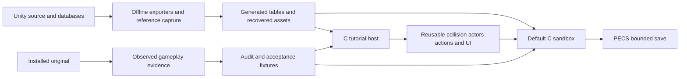

[Halt lock and stop effect](docs/audit/HALT_STOP_EFFECT.md#live-in-both-hosts): `pe_halt_host` applies source Action_Halt once per fixed movement step in `pe_sandbox_view` and `pe_training_view` (Move/Jump refused while the mask is set) and hands the stop effect's offsets to the solve via `pe_sandbox_actor_set_ik_offsets` / `pe_ik_drive_solve_offsets`.

[Always-on FinalIK solve](docs/audit/PLAYER_IK_DRIVE.md): `pe_ik_drive` loads the staged solver poses and the `player-ik-drivers` joint table (`export_player_ik_drivers.py`), solves the drawn clips with no offsets and returns per-bone motions; `pe_actor_pose_blend_driven` and `pe_actor_scene_view_bind_ik`/`set_ik` apply them when `pe_sandbox_actor` and `pe_training_view` draw the player. Presentation only.

[Player solver poses](docs/audit/PLAYER_IK_POSE.md): `pe_ik_pose` loads the staged PEIK1 animated local poses of the solver bones; `export_player_ik_pose.py` derives them offline from the existing isolated-Animator bakes into the `player-ik-pose` group. `pe_ik_skin` gives the rigid per-bone motion from an animated pose to its solved pose.

[FinalIK grounder](docs/audit/FINALIK_GROUNDER.md): `pe_grounder` owns the disconnected installed `GrounderFBBIK` update (root ray, legs, pelvis, spine lean) with a caller ray callback; `export_grounder.py` binds the committed CIL excerpt and regenerates the female settings. `ReferenceGrounderProbe.cs`, `reference_grounder_probe.py` and `analyze_reference_grounder.py` are the prepared observation-only uneven-ground capture and its replay; not yet run in the game.

[FinalIK full-body solver](docs/audit/FINALIK_FBBIK.md): `pe_fbbik` owns the disconnected installed `IKSolverFullBodyBiped` update for the 25-transform female solve hierarchy; `export_fbbik.py` binds the committed CIL excerpt and the prefab's serialized solver. It consumes effector offsets such as `pe_halt`/`pe_hit_ik` requests and returns a local pose; no host uses it.

[AnimFollow drive](docs/audit/ANIMFOLLOW_DRIVE.md): `pe_animfollow_drive` owns disconnected female per-body PD and indexed joint requests; `export_animfollow_drive.py` binds11 bodies/10 joints/66 nonrigids, profiles and collider/material metadata. It supplies no physics or pose.

[Knife recovery](docs/audit/KNIFE_RECOVERY.md): `pe_sandbox_actor` owns the native inactive150ms recovery blend and shared body/attachment/defence snapshot; `pe_sandbox_view` clears it on explicit cancellation. The user accepted the one-click standing/walking ending qualitatively. Separate Knife33 reaction assets remain staged and previewed.

[Reaction preview](docs/audit/REACTION_PREVIEW.md): fixture-only `rebuild/tests/render_reaction_group.c` selects staged leaves through the common scene renderer; `reaction-render-capture` uses the existing private capture supervisor, fresh symlink roots and readback tokens. No production action admission changes.

[Sprint integration](docs/audit/SANDBOX_SPRINT_KNIFE.md): `pe_sprint_root_motion` owns qualified clip401; `pe_sandbox_view` validates complete body/Knife/defence clocks and dispatches retained sprint intervals through the shared motor/contact path. `export_sprint_player.py` appends only the sprint leaf with preserved installation backups. Installed body/Knife22 and defence31 are distinct from staged Wood33/42 and reaction25 groups.

# Planet Explorers project map

[AnimFollow lifecycle](docs/audit/ANIMFOLLOW_LIFECYCLE.md): `pe_animfollow` owns disconnected installed female state/scalar requests and active body policy; `export_animfollow.py` binds shipped CIL and stripped prefab settings through the committed bounded excerpt. Physics, PD and poses remain gated.

[Ragdoll action lifecycles](docs/audit/RAGDOLL_ACTIONS.md): `pe_ragdoll_action` owns disconnected Wentfly/Knocked/GetUp ordered requests and class-keyed freeze reduction; `export_ragdoll_actions.py` binds source methods, rows7/8/10 and the player’s2s Knocked override. Physical ragdoll and get-up poses remain gated.

[Hit IK](docs/audit/HIT_IK.md): `pe_hit_ik` owns disconnected per-part clocks and additive effector requests; `export_hit_ik.py` binds the female transform lists, pinned/duplicate links and force profile. [Current handoff](docs/HANDOFF.md) records the next work.

[Halt stop effect](docs/audit/HALT_STOP_EFFECT.md): `pe_halt` owns the disconnected Halt lifecycle and foot-stop effector offsets; `export_halt_effect.py` binds the C# rules, the female prefab curves and relation row50.

[Lunge motor](docs/audit/SWORD_LUNGE_MOTOR.md): `pe_sword_motor` applies blade root motion to the live Adventure player in source controller order, using the `pe_human_phy` request latch; `pe_sandbox_view.c` calls it around the existing collision step.

[Reaction animation contract](docs/audit/REACTION_PRESENTATION.md): `pe_whacked` owns the disconnected Whacked lifecycle and BeHit exit clock; `export_reaction_presentation.py` binds the installed controller graph, state behaviours, clip identities, relation row5 and a CIL excerpt. `cil_evidence.py` is the shared excerpt builder/checker. `inventory_reference_bake.py` and `reference_animator_bake.py --preset hit-reaction` hold the completed25-clip pose bake; `pe_sandbox_actor` validates its optional second group without selecting or drawing it.

[HumanPhyCtrl qualification](docs/audit/HUMAN_PHY_CTRL.md): `pe_human_phy` owns the disconnected request latch, ground/water/drag state and FixedUpdate force requests; `export_human_phy.py` binds the committed CIL excerpt to the installed assemblies, female prefab and project physics settings. `cil_disasm.py` decodes compiled-only method bodies for reading. PhysX integration and host scheduling remain separate gates.

[Repulsed qualification](docs/audit/REPULSED_ACTION.md): `pe_repulsed` owns disconnected admitted-action clocks and requests; `export_repulsed_action.py` binds the active female curves, row6 relations and static Unity5 angle evidence. Physical motor consumption and reaction presentation remain separate gates.

[Building materials](docs/audit/BUILDING_MATERIALS.md): `export_reference_materials.py` recovers source-bound alpha/culling for both settlement OBJ groups; `pe_reference` retains it and shares `pe_material_view.h` with actors. `pe_sandbox_collision_label_visible` hides sandbox NPC names behind current geometry as a native adapter.

[Checkout relocation](docs/audit/PORTABLE_PATHS.md): `pe_paths.h` owns executable-relative runtime lookup, `read_reference_adventure.source_label/source_path` own portable source labels and hash-checked historical relocation, and `setup_unity_tools.py` repairs movable environment launchers. Archived asset manifests remain unchanged.

[Actor materials](docs/audit/ACTOR_MATERIALS.md): `export_actor_materials.py` recovers alpha/culling policy into optional source-bound sidecars; `pe_actor_scene_manifest` validates them and the shared actor views apply cutouts to both hosts. Existing meshes, textures and animation groups remain unchanged.

[Adventure debug tools](docs/audit/DEBUG_TOOLS.md): `pe_debug` owns atomic medicine/supply/hunt-skip commands; `pe_ui_settings` owns the session toggle and shared controls; `pe_sandbox_view` admits requests and resets transient owners after travel. These are explicit cheats, with no new save format or automatic save.

The private rebuild uses `master` as its working/default branch on remote `origin`. The original Unity source is the pinned, read-only `reference/unity` submodule; the root `Assets`, `ProjectSettings` and sibling links resolve into it.

[Hunt loot](docs/audit/HUNT_LOOT.md): `pe_hunt_loot` owns source rolls, saved world-item identities, whole-stack pickup and expiry; `pe_hunt_loot_combat` commits actual contact deaths with their drops. PECSv22 appends this state without changing the v21 payload. `export_hunt_loot.py` guards the active source path, database and prefab; the sandbox host supplies readonly icon clusters through shared UI primitives.

[Attack preference](docs/audit/MELEE_TARGET_FACING.md#optional-camera-facing-attacks): `pe_preferences` owns user configuration outside world saves, `pe_ui_settings` owns the shared Settings view/input in main menu and both Pause menus, and `pe_melee_facing_request` supplies the optional free-third-person camera direction to both hosts. Default OFF; Sword/Shield activation remains gated.

October7 combat follow-through: [Adventure target/facing](docs/audit/MELEE_TARGET_FACING.md) connects `pe_hunt_targeting` and `pe_melee_facing` to the existing Knife host; camera orientation stays independent. [Hit-reaction decisions](docs/audit/HIT_REACTION.md) remain disconnected pending reaction pose/motor qualification.

The current increment adds [conversation history](docs/audit/CONVERSATION_HISTORY.md), owned by `pe_conversation_history` in PeGame (PECSv21) and the shared `pe_ui_history` renderer; tutorial has a transient owner. [Camera alignment](docs/audit/CAMERA_ALIGNMENT.md) integrates the recovered geometry evaluator with camera-only queries and one shared display pose for rendering/picking. See the linked contracts for native adapters and evidence limits.

The shared UI owners are [pe_ui_draw](rebuild/src/pe_ui_draw.h) (fonts/wrapping/frame primitives), [pe_ui_hud](rebuild/src/pe_ui_hud.h) (HUD, minimap chrome and bounded tracker), [pe_ui_input](rebuild/src/pe_ui_input.h) (shortcuts and pointer ownership), and [pe_training_ui_layout](rebuild/src/pe_training_ui_layout.h) (geometry/window movement). Both host renderers adapt their own state to these owners. [Shared UI rules and review](docs/audit/SHARED_UI.md) prevent separate tutorial/sandbox fixes.

The October7 [ordinary hunt acceptance](docs/audit/HUNT_ORDINARY_ACCEPTANCE.md) now verifies earned kills, exact partial reload, return rewards and resumed ending dialogue. [Private native input](docs/audit/NATIVE_PRIVATE_INPUT.md) enables further isolated normal-game checks without the user desktop; [save inspection](rebuild/tools/inspect_hunt_save.c) covers the full categorized inventory. Earlier pending-hunt statements below describe their historical checkpoints.

The current review batch adds [Restoration Bandage924](docs/audit/SANDBOX_BANDAGE.md), [typed shop quantities and item details](docs/audit/SHOP_QUANTITY_AND_ITEM_DETAILS.md), and a [pure camera geometry evaluator](docs/audit/CAMERA_GEOMETRY.md). Bandage ownership stays in `pe_game`; presentation and edit routing stay in `pe_sandbox_ui`/`pe_sandbox_ui_input`. The camera evaluator and its exporter are independent of the live camera. PECSv20 remains unchanged. [Batch review steps](rebuild/README.md#review-batch-shop-details-bandages-and-repair) include the preceding camp repair integration; current evidence is recorded in PLAYTEST.

This map locates the original Unity reference, the C rebuild and the evidence supporting replication. The immediate implementation direction is sandbox gameplay alignment. The latest source-only integration enables the existing camp repair machine, with one saved item/job owner and a movable modal; full checkpoint validation is tracked separately in PLAYTEST and no new physical service acceptance is claimed. The main menu connects both hosts. They share recovered presentation assets, while sandbox progression and tutorial lesson state remain separate. The sandbox owns source-timed shovel/pickaxe/axe actions, the welcome-to-supplies flow, archived residents, eight shops with284 purchase offers, Annot discovery and medicine quest9072. Dynamic worlds and PECSv20 support an installed reference route, persistent Torch instances and source-pinned hunt travel state; old saves retain their worlds. [PLAYTEST](docs/PLAYTEST.md) records original medicine purchase/crafting/delivery and9075 acceptance, native medicine/save checks, focused Tammana/Sherley shops and native Torch equip/place/Turn/reload/timed Get→Charcoal. These checks do not establish physical coverage of all vendors or exact Torch presentation parity. The original9075 target is archived and native travel acceptance/arrival/persistence pass focused tests; native physical4103 acceptance, ordinary traversal to encounter-pending9126 and reload were also verified. Original medicine delivery uses an earlier completion trigger; the user explicitly chose to retain the native final4100 acknowledgment as an intentional difference. The Torch placement held-input correction passed a physical one-second held-press retest. The latest implementation connects a bounded six-hare controller, exact player defence poses, incoming/outgoing damage and saved four-kill progression. Full sanitizer/leak, final optimized build/tests, content and23 CLI checks pass. Native incoming damage/death/v11 load were physically verified; one outgoing contact is also verified; four-kill completion and partial-progress reload remain next checks. October6 adds automatic9127 rewards/resumable pages and three sandbox camera modes with free mouse by default. That return increment passed full optimized/content/CLI and ASan/UBSan/leak checks; ordinary-interpreter optional UnityPy skips are not passes. Native checks verify free-pointer movement, short RMB interaction, all F5 modes and held-RMB look/release. A staged state3/kills4 fixture verifies automatic return, durable4105/4106 pages and completed save/load with exactly one each of592–595; this does not verify four real kills. Original screenshots show rewards before4105 acknowledgment and4106 leading to9077 opening. See [combat integration](docs/audit/ADVENTURE_HUNT_COMBAT.md) and [return contract](docs/audit/ADVENTURE_HUNT_RETURN.md).

The earlier consumable increment adds independent Portable Medpack925 healing/cooldown and the Tab/F5 correction. Full optimized/content/CLI checks, core and focused sanitizer checks, and physical consumable/save/camera checks pass with the scope recorded in PLAYTEST. Town Defense9077 metadata and scheduling are headless foundations with no enabled native encounter.

The preceding directional asset increment adds twelve runtime locomotion states with actual side/back walk/run clips. Eleven body/attachment scenes now contain matching twenty-clip groups, and the compatible defence actor contains twenty-nine clips. Full optimized/content/CLI checks and focused native asset sanitizer checks pass; native A/D/S run/walk exercised all six new clips (mask4037) and exited0. The full15,000-frame tutorial reached756 and full ASan/UBSan with leak detection passed; a separate captured-camera tutorial run exercised all six new directions (mask4033) and exited0. Moving attacks were unavailable at that preceding checkpoint; the current running increment is documented below. Ordinary full-suite UnityPy skips remain separate from the passed directional asset checks. [Directional recovery](docs/audit/DIRECTIONAL_PLAYER.md) records exact source identities, the coherent installer and preserved backups.

The latest movement correction separates body heading from camera orbit: free third person turns toward actual travel and holds its heading when stopped; captured modes face the camera for side/back steps. Both hosts smooth locomotion pose weights with a 0.12s time constant, sharing the pose with attachments; sandbox Torch mounts and incoming player defence follow that same blend and body yaw. Tool/melee actions retain their exact unblended clocks and facing precedence. These are bounded native adapters, not the full source Animator graph. The corrected build passes full optimized build/tests and core ASan/UBSan with leak detection; the ordinary Python run retains19 optional skips, which are not passes. Physical sandbox free-mode turning/stopped heading and sandbox/tutorial captured transitions are checked. A new15,000-frame tutorial regression exits0 at mission756 with nine NPCs,19 construction additions/one removal/score50, and eight melee starts/24 contacts/hareHP0. These checks do not establish source blend parity, camera-quality acceptance or exhaustive equipment/action-facing coverage. See [facing and blend evidence](docs/audit/PLAYER_STRAFING.md).

The latest running-knife increment adds grounded female third-person Knife33 stage408 with a qualified captured root curve, shared collision/pose/contact ordering and existing Attack7–9 continuations. Matching body/knife/defence assets are installed with backups. Original live03 confirms the running branch and thresholds4.5/7; its software-rendered trace is too coarse for exact motor timing. Full optimized core and ASan/UBSan with leak detection pass, plus44 focused Python tests with0 skips. The broader test suite completed as a composed pass after a stale Torch fixture correction, retaining19 optional UnityPy skips; current content and23 CLI checks pass. The latest15,000-frame tutorial regression also passes at mission756 after a bounded attachment-count compatibility correction; tutorial attacks remain stationary. Native physical checks now record three running starts and visible lunges; a separate hunt run records one running start plus continuation, six aggregate outgoing/eight incoming contacts and player death, with no kills. Both sessions exited0. These counts do not isolate contacts to stage408. Sprint was unsupported at that checkpoint; see the current sprint integration above. Airborne, water/first-person attacks and full Unity motor/blend parity remain unsupported. See [running implementation](docs/audit/SANDBOX_RUNNING_KNIFE.md).

## Read in this order

| Need | Start here |
|---|---|
| Instructions for future agents | [AGENTS.md](AGENTS.md) |
| Binding per-feature rules | [Feature contracts](docs/FEATURE_CONTRACTS.md) |
| Build, run and controls | [rebuild/README.md](rebuild/README.md) |
| Overall scope and delivered systems | [Replication specification](docs/REPLICATION.md) |
| Next sandbox milestone and live original fixtures | [Sandbox alignment](docs/audit/SANDBOX_ALIGNMENT.md) |
| Source-first priorities and when a playtest is needed | [October6 source audit and work order](docs/audit/SOURCE_FIRST_REBUILD.md) |
| Latest source-only reassessment and user recording plan | [Audit after3791d89e](docs/audit/SOURCE_FIRST_CHECKPOINT_REVIEW.md): wallets, inventory, pounce extraction, construction and a30-minute recording plan |
| Revival Shot, death modal and contact grace | [Contract and limitations](docs/audit/SANDBOX_REVIVAL.md), [transient core](rebuild/src/pe_revival.h), [host regression](rebuild/tests/test_sandbox_revival_host.c); no ragdoll/physical acceptance claim |
| Sword branch and movement policy | [Source/math evidence](docs/audit/SWORD_MOTION_POLICY.md), [selector](rebuild/src/pe_sword_variant.h), [shared request](rebuild/src/pe_sword_motion.h); ordinary roots now integrate through the qualified PESR1 group |
| Offline ordinary attack root investigation | [Static native branches and existing-running comparison](docs/audit/PLAYER_ROOT_CHANNELS.md), [verifier](rebuild/tools/verify_player_root_channels.py); bounded extraction proof now complete |
| Grounded walking attacks and ordinary combo motion | [Implementation/evidence](docs/audit/SANDBOX_WALKING_KNIFE.md), [curve owner](rebuild/src/pe_sword_root_motion.h), [exporter](rebuild/tools/export_sword_root_motion.py); installed source knots, focused checks, physical acceptance pending |
| Low-health recovery clocks, damage notification and load lifecycle | [Passive recovery](docs/audit/PASSIVE_RECOVERY.md), [core owner](rebuild/src/pe_passive_recovery.h) |
| Melee endpoint history, source entity centers and collision sampling | [Capsule history audit](docs/audit/MELEE_CAPSULE_HISTORY.md), [numerical owner](rebuild/src/pe_capsule_history.h) |
| Offline humanoid evaluation and remaining limb gap | [697-pose proof](docs/audit/HUMANOID_ROTATION_PROOF.md), [channel mapping](docs/audit/HUMANOID_CHANNEL_MAPPING.md), [experimental C arithmetic](rebuild/tools/human_rotation_math.h); outside runtime CORE |
| Attack contact playback and offline engine curve arithmetic | [Playback](docs/audit/ATTACK_PLAYBACK.md), [numerical qualification](docs/audit/UNITY5_CURVE_EVALUATOR.md), [clock owner](rebuild/src/pe_attack_playback.h) |
| Shield admission, action relations and cancellation | [Headless contract](docs/audit/SHIELD_ACTION.md), [action owner](rebuild/src/pe_shield_action.h); ordinary activation remains gated |
| Stamina pulse ordering, comfort and v16 persistence | [Stamina recovery](docs/audit/STAMINA_RECOVERY.md), [core owner](rebuild/src/pe_stamina_recovery.h) |
| What was actually tested | [Playtest record](docs/PLAYTEST.md) |
| Help test the current build | [Ordinary four-hare acceptance and isolated checkpoint](docs/audit/HUNT_ACCEPTANCE.md); [movement/camera checklist](docs/PLAYTEST.md#hands-on-checklist--current-movement-and-running-knife-build) |
| Extend or verify running Knife33 | [Running implementation and evidence](docs/audit/SANDBOX_RUNNING_KNIFE.md), [live branch capture](docs/audit/RUNNING_KNIFE_LIVE_OBSERVER.md) |
| Launch the installed original | [Reference runtime](docs/REFERENCE_RUNTIME.md) |
| Search dependencies and asset identity | [Local knowledge graph](docs/KNOWLEDGE_GRAPH.md) |

Town Defense reference tooling: [bounded beacon observer](docs/audit/ADVENTURE_TOWN_DEFENSE_OBSERVER.md) records original9077 waves and actors through an explicit isolated launch. Its offline build/tests do not enable native defense or establish a live capture.

Creature recovery: [generic sampler prerequisites](docs/audit/CREATURE_SAMPLER_PREREQUISITES.md) and [read-only inventory](rebuild/tools/inventory_creature_sampler.py) qualify installed wolf/rhino hierarchy, Avatar/controller references and material groups. Unresolved clip bindings remain explicit; runtime sampling and playable defense are not yet qualified.

Combat comparison: [hunt difficulty and equipment audit](docs/audit/HUNT_DIFFICULTY.md) distinguishes the intended quest order from missing native outfit defense and sword/shield support. [Starter outfit ownership](docs/audit/STARTER_OUTFIT.md) now supplies defense, per-hit wear and v14 persistence; general armor swaps and sword/shield combat remain separate work. The completed clothing increment passes full optimized/core/content/CLI and ASan/UBSan with leak detection; a physical eight-hit save/reload preserves wear and identities exactly. It does not establish hunt survival parity. The next equipment contract is [Wood Sword and Wood Shield](docs/audit/STARTER_SWORD_SHIELD.md).

Conversation controls: [numbered responses](docs/audit/NUMBERED_CONVERSATIONS.md) adds top-row/keypad1–9 to both hosts, sharing visible order with input routing and retaining modal ownership through the closing frame. The [full-HP hunt lifecycle test](rebuild/tests/test_hunt_lifecycle.c) earns blade-contact kills, reloads at1/3 kills and verifies fourth-kill cleanup and one-time return rewards; its arranged geometry does not establish ordinary combat completion.

## Directory map

| Location | Role |
|---|---|
| [Assets](Assets) | Original C#, serialized Unity content, shaders, metadata and embedded database. Reference input. |
| [ProjectSettings](ProjectSettings) | Unity version/build configuration. Reference input. |
| [ConfigFiles](ConfigFiles), [config](config), [i18n.db](i18n.db) | Original configuration and localization. |
| [TutorialMode](TutorialMode), [CustomGames](CustomGames), [RandomTownArt](RandomTownArt), [CustomSounds](CustomSounds) | Original terrain/scenario/town/audio fixtures; not a complete installed game. |
| [rebuild/src](rebuild/src) | C11 runtime, headless state/geometry and raylib presentation. |
| [rebuild/generated](rebuild/generated) | Exported C tables/text/mound data and provenance manifests. Regenerate from tools. |
| [rebuild/tools](rebuild/tools) | Offline exporters, reference launch/input/capture/analysis and structural indexer. |
| [rebuild/tests](rebuild/tests) | C, Python, source cross-check, CLI and graphics fixtures. |
| `rebuild/build` | Ignored executables, recovered runtime assets, expensive sampled animations, captures and local indexes. Not disposable as a whole without checking contents. |
| [docs/audit](docs/audit) | Source investigations and bounded implementation contracts. |
| [docs/reference](docs/reference) | Preserved screenshots/results, including [sandbox session metadata](docs/reference/sandbox/session.json). |

## Runtime ownership

The [Makefile](rebuild/Makefile) lists the actual `CORE`, `FRONTEND`, generated dependencies and test targets. The following groups are navigation aids, not independent libraries.

| Area | Main owners | Current boundary |
|---|---|---|
| Entry/main menu | [main.c](rebuild/src/main.c), [pe_app_menu.c](rebuild/src/pe_app_menu.c), [pe_sandbox_view.c](rebuild/src/pe_sandbox_view.c), [pe_game.c](rebuild/src/pe_game.c) | Menu routes retain sandbox state across tutorial visits; separate graphics sessions. Adventure starter/supplies, recipe knowledge, quickslots and bounded exploration. |
| Reference settlement | [pe_settlement.c](rebuild/src/pe_settlement.c), [export_adventure_settlement_assets.py](rebuild/tools/export_adventure_settlement_assets.py), [reference_terrain.py](rebuild/tools/reference_terrain.py) | Original64×32×128 settlement and optional416×64×416 route, with matching borrowed building collision. [Settlement](docs/audit/ADVENTURE_SETTLEMENT.md), [route storage/capture](docs/audit/ADVENTURE_ROUTE.md); bounded recovered fixtures, not procedural generation. |
| Terrain | [pe_world.c](rebuild/src/pe_world.c), [pe_mesh.c](rebuild/src/pe_mesh.c), [pe_legacy.c](rebuild/src/pe_legacy.c) | Owned inline/heap density worlds with clone/move/destroy APIs, dynamic32³ mesh regions and read-only `.voxelform`/LZ4 crops. General hosts use dimensions/data accessors; no full streaming/generator parity. |
| Terrain materials | [pe_terrain_material.c](rebuild/src/pe_terrain_material.c), [pe_terrain_material_view.c](rebuild/src/pe_terrain_material_view.c), [export_terrain_assets.py](rebuild/tools/export_terrain_assets.py) | Six recovered atlases,84 source IDs, triplanar triangle blending and crop-origin UVs. Synthetic palette aliases are presentation choices; simulation/save IDs stay unchanged. [Audit](docs/audit/SANDBOX_TERRAIN_MATERIALS.md). |
| Construction | [pe_block.c](rebuild/src/pe_block.c), [pe_training_build.c](rebuild/src/pe_training_build.c), [pe_training_receiver.c](rebuild/src/pe_training_receiver.c) | Shared packed Block45 geometry; sandbox transactions and tutorial point-brush/receiver host remain distinct. |
| Physics/query foundation | [pe_scene_collision.c](rebuild/src/pe_scene_collision.c), [pe_training_terrain.c](rebuild/src/pe_training_terrain.c), [pe_training_terrain_view.c](rebuild/src/pe_training_terrain_view.c) | BVH/capsule queries and tutorial render/collision snapshots. [pe_sandbox_collision.c](rebuild/src/pe_sandbox_collision.c) snapshots actual sandbox MC/Block45/box geometry and live source tree capsules for Adventure movement and save validation; tree-excluding geometry queries serve the camera. Snapshots are external to saved state. |
| Camp repair service | [owner](rebuild/src/pe_camp_repair.h), [saved state](rebuild/src/pe_camp_repair_state.h), [spatial owner](rebuild/src/pe_camp_repair_interaction.h), [source contract](docs/audit/CAMP_REPAIR.md), [interaction audit](docs/audit/CAMP_REPAIR_INTERACTION.md) | Archived machine20006, exact bag-instance transfer, confirmed material debit/cancel,60-second display clock, movable modal and PECSv20 reserved item/job. Source profiles exclude Knife33/SafetyAxe1527; worn/creation/LifeLimit repair and animated machine presentation remain unsupported. |
| Camera geometry qualification | [audit](docs/audit/CAMERA_GEOMETRY_GATE.md), [CPU probe](rebuild/tools/reference_camera_geometry.c) | Active near-plane/ring math and native query/projection differences; remaining clamp is not integrated. |
| Camera environment | [owner](rebuild/src/pe_sandbox_camera.h), [source exporter](rebuild/tools/export_camera_environment.py), [audit](docs/audit/CAMERA_ENVIRONMENT.md) | Adventure66-ray activity target and source two-second obstruction recovery; actual host/collision checks, native framing/near-plane limitations. |
| Hare pounce preparation | [owner](rebuild/src/pe_hare_pounce.h), [audit](docs/audit/HARE_POUNCE_PREPARATION.md) | Isolated lifecycle/requests and qualified staged ninth clip; production hunt aggression and collision integration remain disabled. |
| Follow-up recipe closure | [source exporter](rebuild/tools/export_content.py), [audit](docs/audit/ADVENTURE_FOLLOWUP_CATALOG.md), [real learning/crafting tests](rebuild/tests/test_followup_catalog.c) | Nine additional books and thirteen formulas; definitions do not enable colony or vehicle behavior. |
| Typed mission events | [owner](rebuild/src/pe_adventure_mission_events.h), [audit](docs/audit/ADVENTURE_MISSION_EVENTS.md) | Disconnected9077–9084 ordering, grant latches and injected atomic effects; no live quest/save integration. |
| Inventory discard | [core](rebuild/src/pe_game.h), [UI route](rebuild/src/pe_sandbox_ui_input.c), [audit](docs/audit/INVENTORY_DISCARD.md) | Confirmed whole-slot destruction, protected ownership and stale-selection checks; split first for partial disposal. |
| Defense spawning foundation | [owner](rebuild/src/pe_town_defense_spawn.h), [audit](docs/audit/TOWN_DEFENSE_SPAWN.md) | Injected source wave plans, pending/created member identity and beacon death credit; no live9077, geometry completion or save integration. |
| Sandbox camera | [pe_sandbox_camera.c](rebuild/src/pe_sandbox_camera.c), [pe_sandbox_view.c](rebuild/src/pe_sandbox_view.c), [source camera audit](docs/audit/SANDBOX_CAMERA.md) | Default free-mouse third person; F5 cycles free/captured third person/first person. F5 can leave the Tab cursor override while UI ownership still has priority. Free-mode RMB captures after3px motion or.25s hold; a short stationary release interacts/stows. Source zoom/activity bounds, obstruction recovery and verified Unity 5.2 scalar SmoothDamp(.5 s) share one display-frame clock with gated wheel input. Native camera framing, near-plane geometry and the remaining CameraForge graph differ. Tree layers remain excluded from camera blockers. |
| Vendor wallets | [pe_town_wallet.c](rebuild/src/pe_town_wallet.c), [export_town_wallets.py](rebuild/tools/export_town_wallets.py), [contract](docs/audit/TOWN_WALLETS.md) | Eight archived purses, atomic normal-purchase credit, observed noon refill latch and v17 migration; source-priced selling/buyback use the separate trade owner. |
| Persistence | [pe_save.c](rebuild/src/pe_save.c) | PECSv20 retains literal v19 plus32 bytes for entity20006, one reserved item/count/instance/wear, running flag and remaining100000-Hz ticks. Pre-v20 initializes an empty machine; alias/crop/profile/clock failures reject the entire load. V19 retains the v18 wire layout plus26888 bytes for category storage; validates the compact32-cell prefix against all1680 authoritative cells and migrates old Adventure bags without losing instance identity. V18 retains literal v17 plus648 bytes of fixed vegetation/depletion records; pre-v18 infers no patch. V17 retains literal v16 plus100 bytes of eight identified wallet/latch records; older Adventure saves initialize archived profiles. V16 retains literal v15 plus4 bytes of raw comfort; older saves default to500. V15 retains literal v14 plus4 bytes selecting one bag-owned shield instance; normal shield use remains gated. V14 retains literal v13 plus36 bytes of three worn clothing identities/durabilities; pre-v14 Adventure validates then initializes intact starter clothes. V13 retains the literal v12 payload plus4-byte medpack cooldown; pre-v13 defaults0. V12 retains the literal v11 payload without an append and adds hunt states4/5/6 for durable return dialogue/completion; pre-v12 rejects those states. V11 retains the literal v10 payload and adds a32-bit hunt kill count; v10 retains medicine/284 stocks and hunt destination plus64 deployed instance records; older saves default those new fields to zero; v1–3 migrate as Legacy, while v4 Adventure can relocate a tree-overlapping player up to 3 m along a safe same-height path. Failed migration leaves current state unchanged. Earlier save migrations remain; welcome page0..9, Adventure progression/quickslots/HP and consumable clocks persist; not Unity saves or full tutorial persistence. |
| Tutorial state/controller | [pe_tutorial.c](rebuild/src/pe_tutorial.c), [pe_training.c](rebuild/src/pe_training.c), [pe_training_view.c](rebuild/src/pe_training_view.c) | Recovered-room lessons, movement/cameras, input and smoke sequence through construction; creation lesson 756 unsupported. |
| Sandbox tool clocks | [pe_sandbox_actions.c](rebuild/src/pe_sandbox_actions.c), [pe_sandbox_actions.h](rebuild/src/pe_sandbox_actions.h) | Transient, fixed-step source timing for Adventure items12/19/26/1527; one owner of authored events and renderer pose clocks. Source transitions are approximated; Wood Pickaxe19 has recovered Mine1–3 poses and exact event clocks. |
| Recovered sandbox trees | [pe_sandbox_world_view.c](rebuild/src/pe_sandbox_world_view.c), [export_sandbox_world_assets.py](rebuild/tools/export_sandbox_world_assets.py), [pe_tree_collision.c](rebuild/src/pe_tree_collision.c), [export_tree_collision.py](rebuild/tools/export_tree_collision.py) | Shared original diffuse tree at provisional saved positions; source trunk-capsule interaction rays, Adventure movement collision and depletion visibility. Generated headless constants match the visual PESC. No species generation or wind/LOD parity. |
| Tutorial tool and gathering actions | [pe_training_melee.c](rebuild/src/pe_training_melee.c), [pe_training_tree_hit.c](rebuild/src/pe_training_tree_hit.c), [pe_training_dig.c](rebuild/src/pe_training_dig.c), [pe_training_gathering.c](rebuild/src/pe_training_gathering.c) | Tutorial-specific grants, targets and progression remain here; the general shovel/axe host has no lesson side effects. General melee/gathering still need integration. |
| Actors and clips | [pe_actor.c](rebuild/src/pe_actor.c), [pe_actor_scene.c](rebuild/src/pe_actor_scene.c), [pe_actor_scene_view.c](rebuild/src/pe_actor_scene_view.c), [pe_player_locomotion.c](rebuild/src/pe_player_locomotion.c) | [pe_sandbox_actor.c](rebuild/src/pe_sandbox_actor.c) owns transient body facing and adapts twelve measured-velocity locomotion states with continuous gait phase and 0.12s pose-weight smoothing. Free mode turns into travel; captured modes face camera. Body, held/stowed tools, Torch mounts and incoming defence share the blended pose; exact shovel/felling/mining/melee clocks override it. The shared directional prefix has twenty clips; the installed body/knife groups append running408 as clip21 and defence appends it as clip30. Other tools retain their matching directional/action groups. Sampled animation, multipart appearances and rendering; not a full Animator/retargeting implementation. |
| Contact/creature rules | [pe_hitbox.c](rebuild/src/pe_hitbox.c), [pe_knife_contact.c](rebuild/src/pe_knife_contact.c), [pe_combat.c](rebuild/src/pe_combat.c), [pe_hare.c](rebuild/src/pe_hare.c), [pe_hare_attack.c](rebuild/src/pe_hare_attack.c) | Bounded source geometry/action helpers; general AI, encounter permission and survival still need a host. |
| Sandbox knife | [pe_sandbox_melee.c](rebuild/src/pe_sandbox_melee.c), [pe_running_attack_motion.c](rebuild/src/pe_running_attack_motion.c), [pe_root_motion.c](rebuild/src/pe_root_motion.c), [running audit](docs/audit/SANDBOX_RUNNING_KNIFE.md) | Exact-instance stationary and female TP running Knife33; one outgoing action interval, qualified408 displacement through shared collision, then blade/defence at the resulting pose. Attack7–9 retain zero horizontal motion. Original branch and headless checks pass; native checks verify running starts/presentation and aggregate hunt contacts; four-kill completion and partial reload remain pending. |
| Bounded hunt combat | [pe_hunt_combat.c](rebuild/src/pe_hunt_combat.c), [pe_hunt_encounter.c](rebuild/src/pe_hunt_encounter.c), [pe_hare_skill.c](rebuild/src/pe_hare_skill.c), [combat audit](docs/audit/ADVENTURE_HUNT_COMBAT.md), [pe_hare_damage.c](rebuild/src/pe_hare_damage.c), [damage audit](docs/audit/HARE_DAMAGE.md), [encounter capture](docs/audit/ADVENTURE_HUNT_ENCOUNTER.md), [route test](rebuild/tests/test_hare_route.c) | Generalized Adventure patrol/collision, authored forearm contact and real-route preparation of six observed anchors. Two original reloads generated different cohorts at0/4. The native pinned cohort now connects bounded perception/melee, independent guide clocks, authoritative HP, real death credit and saved count persistence; full original AI and random reload remain outside scope. Return progression belongs to pe_adventure_hunt. |
| Tutorial NPCs | [pe_training_npc.c](rebuild/src/pe_training_npc.c), [pe_training_npc_view.c](rebuild/src/pe_training_npc_view.c) | Nine recovered appearances/idles; not Adventure population logic. |
| Adventure encounters | [pe_adventure_npc.c](rebuild/src/pe_adventure_npc.c), [pe_adventure_npc_view.c](rebuild/src/pe_adventure_npc_view.c), [pe_adventure_dialogue.c](rebuild/src/pe_adventure_dialogue.c), [population exporter](rebuild/tools/export_adventure_population.py) | Twenty-five pinned archived individuals, exact supported XZ/heading, male/female query shapes and recovered idle appearances. Role visibility follows bounded plot prerequisites; dialogue/poses are transient. No general generation, scheduling, recruitment or combat. |
| Inventory storage/editing | [pe_inventory.c](rebuild/src/pe_inventory.c), [source exporter](rebuild/tools/export_inventory.py), [contract](docs/audit/SANDBOX_INVENTORY.md) | Four420-cell Adventure categories, split, swap, explicit merge and source consolidation/sort; stable IDs/wear, paged sandbox UI and PECSv19 migration. Legacy/tutorial remain32 cells. |
| Harvest calculations | [pe_harvest](rebuild/src/pe_harvest.h), [source exporter](rebuild/tools/export_harvest.py), [contract](docs/audit/SANDBOX_HARVESTING.md) | Qualified tree48 hardness, scaled primary/optional production and herb fallback/seed drops; inventory/RNG rollback through actual tool/host clocks. Fixed runtime unit scale; Gather animation remains an adapter. |
| Fixed vegetation examples | [pe_vegetation](rebuild/src/pe_vegetation.h), [view](rebuild/src/pe_vegetation_view.h), [contract](docs/audit/SANDBOX_VEGETATION.md), [source](docs/audit/SANDBOX_VEGETATION_SOURCE.md) | Two trees, six herbs and two decorative plants, supported fixed placement, source production and persistent depletion; no procedural spawns or regrowth. |
| Construction undo/redo | [pe_build_history](rebuild/src/pe_build_history.h), [source exporter](rebuild/tools/export_build_history.py), [contract](docs/audit/CONSTRUCTION_HISTORY.md) | Five transient cube/ramp batches, source material rounding, atomic retry and immediate collision refresh; B-mode Ctrl+Z/Ctrl+X and toolbar buttons. PECSv17 unchanged; visual acceptance pending. |
| Vendor selling and buyback | [pe_town_trade](rebuild/src/pe_town_trade.h), [price exporter](rebuild/tools/export_town_trade_prices.py), [contract](docs/audit/TOWN_SELL_BUYBACK.md) | Atomic source condition pricing, exact-instance transfer, separate transient repurchase lists and Buy/Sell/Buyback shop tabs. PECSv17 unchanged; graphical acceptance pending. |
| Town transactions/progression | [pe_town_interaction.c](rebuild/src/pe_town_interaction.c), [offer exporter](rebuild/tools/export_town_interaction.py), [audit](docs/audit/ADVENTURE_TOWN_INTERACTIONS.md) | Seventeen retained starting-town offers plus267 offers across five archived Annot vendors; atomic inventory/currency/stock changes, entity/store identity and source refresh clocks. Strict discovery4503 completes9032. |
| Medicine quest | [pe_adventure_medicine.c](rebuild/src/pe_adventure_medicine.c), [source exporter](rebuild/tools/export_adventure_medicine.py), [audit](docs/audit/ADVENTURE_MEDICINE.md) | Source9072 acceptance via4097 grants877; readiness requires current917×5 possession; user-selected final4100 acknowledgment atomically removes those items and grants925×10 plus554, intentionally later than the original4099 selection. Persistent quest state, transient modal dialogue and ordinary learned-formula crafting remain separate. The following9074 conversation is integrated separately; skill-tree rewards remain unported. |
| Post-medicine quest | [pe_adventure_hunt.c](rebuild/src/pe_adventure_hunt.c), [exporter](rebuild/tools/export_adventure_hunt.py), [archive audit tool](rebuild/tools/audit_reference_hunt.py), [audit](docs/audit/ADVENTURE_POST_MEDICINE.md) | Source9074 conversation and explicit9075/9076 choices; Travel uses archived4524 source(-349,19.5,233), with supported-route acceptance and strict15m XZ arrival checked in C. Original acceptance/arrival are archived; native physical acceptance, ordinary traversal and reload reached the explicit encounter-pending boundary. The bounded9126 host credits real deaths;9127 then automatically grants scripts592–595 once within strict5m XZ of archived4525 and persists ending pages4105/4106 in v12. Atomic capacity retry is an explicit native adapter; skill-tree buffs, plot4 NPC movement and9077 remain unavailable. See [return audit](docs/audit/ADVENTURE_HUNT_RETURN.md). Incoming damage/death/load are physically checked; one outgoing contact is also checked; four-kill completion and partial-progress reload remain unverified physically. |
| Torch Sword-pose recovery | [recovery audit](docs/audit/TORCH_SWORD_RECOVERY.md) | Optional authored Sword pose/transition capture preparation; current runtime still uses verified Torch mounts with the Normal-pose adapter. Capture tooling is not evidence that Sword presentation has been integrated. |
| Torch equipment/deployment | [pe_deployable.c](rebuild/src/pe_deployable.c), [view](rebuild/src/pe_deployable_view.c), [pe_sandbox_actor.c](rebuild/src/pe_sandbox_actor.c), [audit](docs/audit/SANDBOX_DEPLOYABLES.md) | Exact purchased Torch10 identity/wear moves from inventory to held/stowed or placed state. Source trigger picking, turn and strict greater-than2-second Get→Charcoal; recovered model/flame and bounded terrain lighting. No Torch melee, water extinguishing, armor or bed implementation. |
| UI | [pe_ui_assets.c](rebuild/src/pe_ui_assets.c), [pe_training_ui.c](rebuild/src/pe_training_ui.c), [pe_training_ui_layout.c](rebuild/src/pe_training_ui_layout.c) and `pe_training_ui_*` | Recovered atlas/font/effects with tutorial inventory, character, missions, Replicator and room minimap. [pe_sandbox_ui.c](rebuild/src/pe_sandbox_ui.c) and [pe_sandbox_ui_input.c](rebuild/src/pe_sandbox_ui_input.c) bind those assets/layouts to real PeGame state, the dynamic terrain minimap, borrowed resident markers, modal draggable shops with scrolling catalogs, medicine/hunt travel objectives, Torch Get/Turn and an independent bounded build toolbar; routed clicks retain ownership through release and defer gameplay pointer capture, so closing a modal cannot also edit the world. |
| Consumables | [pe_game.c](rebuild/src/pe_game.c), [content exporter](rebuild/tools/export_content.py), [audit](docs/audit/SANDBOX_CONSUMABLES.md) | Herbal Juice916 retains its timed buff; Portable Medpack925 heals350 immediately with an independent10s cooldown. Bag/quickslots share one owner; v13 saves the medpack timer and UI reads it. |
| Sword targeting foundation | [pe_sword_targeting.c](rebuild/src/pe_sword_targeting.c), [tests](rebuild/tests/test_sword_targeting.c), [next combat audit](docs/audit/SANDBOX_COMBAT_NEXT.md) | Pure ordered source acquisition; Adventure now uses the source capsule/posed-defence bridge with explicit stable cohort order and independent heading-only facing. See [current integration](docs/audit/MELEE_TARGET_FACING.md). |
| Defense foundations | [pe_town_defense_clock.c](rebuild/src/pe_town_defense_clock.c), [metadata exporter](rebuild/tools/export_adventure_town_defense.py), [audit](docs/audit/ADVENTURE_TOWN_DEFENSE.md) | Disconnected30/10/20-second schedule, Ready/wake semantics and guarded two-wave/species metadata. No enabled9077 host, actual cohort or defense persistence. |
| Starter shield foundation | [pe_shield.c](rebuild/src/pe_shield.c), [pe_hunt_combat.c](rebuild/src/pe_hunt_combat.c), [pe_save.c](rebuild/src/pe_save.c) | Exact bag-owned item34 reference, v15 persistence, staged incoming-hit defense/block mitigation/wear; normal equip/block controls remain disabled. [Ownership](docs/audit/SHIELD_OWNERSHIP.md). |
| Wood Sword wear and host readiness | [pe_sword.c](rebuild/src/pe_sword.c), [wear audit](docs/audit/SWORD_WEAR.md), [host regression](rebuild/tests/test_sandbox_equipment_host.c) | Exact bag-owned item1 loses5 durability per admitted contact; exhaustion removes its attack bonus but permits attacks. Shared render/defence pose selection and UI readiness are staged; normal Sword/Shield use remains gated. |
| Text and content | [pe_content.h](rebuild/src/pe_content.h), [pe_training_text.c](rebuild/src/pe_training_text.c), [generated content manifest](rebuild/generated/content_manifest.json) | 341 source item definitions and108 formulas, including Annot vendor, medicine, hunt-return and disconnected9077–9084 recipe dependencies. Formula learning follows source item component classes; full equipment, item-use and skill-tree behavior remain bounded. |

## Original source landmarks

| Question | Source location |
|---|---|
| Startup, mode and world loaders | [Assets/PeLauncher](Assets/PeLauncher), [SingleGameInitData.cs](Assets/PeWorld/SingleGameInitData.cs) |
| Entity state, motion and equipment | [Assets/Scripts/PeEntity](Assets/Scripts/PeEntity), [Assets/Scripts/Items](Assets/Scripts/Items) |
| Default controls | [PeInputSettings.cs](Assets/Scripts/Input/PeInputSettings.cs), [PeInput.cs](Assets/Scripts/Input/PeInput.cs) |
| Terrain/extraction/streaming | [Voxel source](Assets/Terrain/Voxelform2/Voxelform/Source), [world audit](docs/audit/WORLD.md) |
| Procedural world configuration | [RandomMapConfig.cs](Assets/Scripts/PuJi/Town/Tool/RandomMapConfig.cs) |
| Camera behavior | [Assets/PeCamera](Assets/PeCamera) |
| Pickaxe action and recovery | [Mine audit and capture plan](docs/audit/SANDBOX_PICKAXE.md); exact Wood Pickaxe19 identity, Mine1–3 clocks, captured mounts and the implemented bounded action group. |
| Adventure NPC interaction | [MousePicker](Assets/Scripts/MousePicker), [BiologyViewCmpt.cs](Assets/Scripts/PeEntity/Cmpt/BiologyViewCmpt.cs), [encounter audit](docs/audit/ADVENTURE_NPC.md); source4.5m bounds,100m camera ray and10m obstacle allowance. |
| Database and paths | [LocalDatabase.cs](Assets/Scripts/Database/LocalDatabase.cs), [GameConfig.cs](Assets/Scripts/System/GameConfig.cs), [localData.bytes](Assets/Resources/DataBase/localData.bytes) |
| Original UI | [PE_GameUI](Assets/Scripts/Chenzhi/NewUI/Scripts/PE_GameUI), [training UI audit](docs/audit/TRAINING_UI.md) |

Many Unity scenes/prefabs are binary and some required shipped content/plugins are absent. Use the serialized-asset exporters and installed reference where appropriate; a text search or structural graph cannot recover those relationships completely.

## Audit and exporter map

| Workstream | Evidence and tools |
|---|---|
| Sandbox | [Gameplay](docs/audit/SANDBOX_GAMEPLAY.md), [world](docs/audit/SANDBOX_WORLD.md), [presentation](docs/audit/SANDBOX_PRESENTATION.md), [general actions](docs/audit/SANDBOX_ACTIONS.md), [tool presentation](docs/audit/SANDBOX_TOOL_PRESENTATION.md); `export_sandbox_world_assets.py` |
| Content/terrain | [Content audit](docs/audit/CONTENT.md), [terrain parity](docs/audit/TERRAIN_PARITY.md), [Block45](docs/audit/BLOCKS.md); `export_content.py`, `export_mc_tables.py`, `export_training_terrain.py` |
| Player/actions | [Player recovery](docs/audit/PLAYER_ASSET_RECOVERY.md), [Animator bake](docs/audit/ANIMATOR_BAKE.md), [hitboxes](docs/audit/HITBOX_RECOVERY.md); `export_reference_player.py`, `reference_animator_bake.py`, `export_baked_knife.py`, `export_baked_axe.py`, `export_baked_shovel.py` |
| Directional player group | [Source branches and installation](docs/audit/DIRECTIONAL_PLAYER.md); [inventory_reference_bake.py](rebuild/tools/inventory_reference_bake.py), [reference_animator_bake.py](rebuild/tools/reference_animator_bake.py), [export_directional_player.py](rebuild/tools/export_directional_player.py), [export_player_defence.py](rebuild/tools/export_player_defence.py). Fresh twenty-clip capture → eleven matching scenes plus twenty-nine-clip defence, with validated backup/rollback installation. |
| NPC/UI | [NPCs](docs/audit/TRAINING_NPCS.md), [UI](docs/audit/TRAINING_UI.md), [effects](docs/audit/UI_EFFECTS.md); `export_training_npcs.py`, `reference_npc_bake.py`, `export_training_ui.py`, `export_training_ui_effects.py`, `export_training_ui_text.py` |
| Adventure supplier | [Encounter and source window](docs/audit/ADVENTURE_NPC.md), [archived appearance](docs/audit/ADVENTURE_SUPPLIER_APPEARANCE.md), [grant provenance](docs/audit/SANDBOX_GAMEPLAY.md); `read_reference_adventure.py`, `export_adventure_supplier.py`, `export_adventure_npc_collider.py`, `export_adventure_dialogue.py`. Generated capsule/text headers and JSON provenance live in `rebuild/generated`; recovered multipart scene/PESC live under `build/reference-assets/adventure-supplier`. |
| Population and route | [Population](docs/audit/ADVENTURE_POPULATION.md), [shops/arrival](docs/audit/ADVENTURE_TOWN_INTERACTIONS.md), [medicine](docs/audit/ADVENTURE_MEDICINE.md), [route](docs/audit/ADVENTURE_ROUTE.md); `export_adventure_population.py`, `export_town_interaction.py`, `reference_terrain_route.py`, `export_adventure_route.py`, `export_adventure_route_assets.py`. |
| Torch assets | [Purchased items](docs/audit/SANDBOX_PURCHASED_ITEMS.md), [deployables](docs/audit/SANDBOX_DEPLOYABLES.md); `export_torch_assets.py`, `export_baked_torch.py`. Shared raw item-local mesh, exact held/stowed mounts, current-source gameplay metadata and separate installed visual provenance. |
| Original operation | [Reference runtime](docs/REFERENCE_RUNTIME.md), [pose tool guide](rebuild/tools/REFERENCE_POSE.md); `launch_reference.py`, `reference_input.py`, pose/bake probes |

Tool names in this table live in [rebuild/tools](rebuild/tools). Individual audits and the rebuild README contain full ordered commands and prerequisites; exporter names alone are not a complete recovery recipe.

## Next implementation gates

The [sandbox work order](docs/audit/SANDBOX_ALIGNMENT.md) is the detailed authority. Mode/progression/inventory ownership, render-derived terrain/construction collision, save validation, recovered actors/UI and the first general source tool clocks are now connected. Camera controls and staged9127 presentation/save-resume are physically checked. Earlier native directional input and drawn-knife presentation are checked. Independent free-mode facing and locomotion smoothing now have focused physical checks and a new full tutorial regression; broader equipment/action-facing and camera-quality acceptance remain separate checks. Grounded running-attack poses are now recovered and staged; next validate root displacement and integrate the source action with shared collision, then verify four real combat kills/cleanup and partial-combat-progress reload; measure original guide/Animator timing and nonzero-kill reload/reporting, then narrow documented AI/contact differences. Return core transactions and durable pages are implemented, while9077 remains unavailable. Broader tool/resource/species and survival coverage remain separate work. Chunk streaming and exact procedural-world generation are major separate stages.

The reference milestone is Westina welcome → Arrival → supplier interaction → source dialogue acknowledgment → learn → craft → equip → dig → build → save/reload. The archived supplier, headless query/placement and atomic dialogue/grant tests pass; the integrated supplier graphics/input check also passes. The later bounded settlement/population/route work adds archived layout and residents, but does not recover population generation or wider NPC behavior. Single Player Build instead starts with stockpiles/known recipes and locked resource counts. Do not transplant its rules into Adventure or substitute the tutorial's fixed NPC roster for generated settlements.

Navigation maintained on 2026-10-06. Module descriptions include October6 return, medpack/v13, camera, directional actors and disconnected defense foundations; original Adventure/Build observations remain dated October 3. Consult the playtest record for completed graphical runs rather than inferring validation from this index.

Supplier regression entry points: [adventure_supplier_fixture.c](rebuild/tests/adventure_supplier_fixture.c) creates an unclaimed, physically supported encounter save; [playtest_adventure_supplier.py](rebuild/tools/playtest_adventure_supplier.py) drives only the owned C window and verifies cancellation, final acceptance and reload. [Recorded evidence](docs/reference/sandbox/rebuild-supplier-result.json).

Welcome entry points: [flow audit](docs/audit/ADVENTURE_WELCOME.md), [appearance](docs/audit/ADVENTURE_WELCOME_APPEARANCE.md), `test_adventure_welcome.c`, and `playtest_adventure_welcome.py`. The existing supplier fixture accepts `--welcome` to create an untouched introduction save.

Shared panel positioning and tracker clearance live in `pe_training_ui_layout.c/.h`. `PeUIWindows` holds session-only offsets for the five movable panels; tutorial and sandbox must use the same translated draw/hit geometry. `playtest_ui_windows.py` exercises both hosts at1000×700 and1280×720.

Town regression entry points: [transactions and save roundtrip](rebuild/tests/test_town_interaction.c), [population placement/sex queries](rebuild/tests/test_adventure_population.c), and [modal UI routing](rebuild/tests/test_sandbox_ui.c). Placement explicitly reports absent assets and out-of-crop actors; these are not passes for uncovered residents or graphical travel.

Latest persistence regression: [test_v10_save.c](rebuild/tests/test_v10_save.c) covers deployed identity/wear/turns, literal v9 migration, malformed-load atomicity and one-time Charcoal retrieval. The [earlier checkpoint inventory](docs/reference/hunt-capture-inventory.json) predates original acceptance. [Fresh save4 evidence](docs/reference/hunt-original-save.json) now pins the real destination, and focused hunt/v10 tests cover supported acceptance, strict arrival and active/pending hunt persistence. [Original inventory evidence](docs/reference/hunt-original-inventory.json) confirms medicine consumption/rewards and395 remaining currency.

Earlier combat persistence: [test_v11_save.c](rebuild/tests/test_v11_save.c) covers hunt count/state validation and literal v10 migration. [Combat audit](docs/audit/ADVENTURE_HUNT_COMBAT.md) owns the current controller, pose and evidence boundaries; prior v10/encounter-pending checkpoints above retain their historical scope.

Latest return persistence: [test_hunt_return.c](rebuild/tests/test_hunt_return.c) covers strict arrival, atomic rewards, capacity retry and guarded dialogue acknowledgment; [test_v12_save.c](rebuild/tests/test_v12_save.c) covers the unchanged v11 payload, durable pages and rejection of new states in older versions. [Return audit](docs/audit/ADVENTURE_HUNT_RETURN.md) separates source contracts, native adapters and pending original/physical checks.

Current consumable persistence: [test_v13_save.c](rebuild/tests/test_v13_save.c) covers the literal v12 prefix, independent medpack timer, pre-v13 zero default and malformed-load atomicity. [test_game.c](rebuild/tests/test_game.c), [UI tests](rebuild/tests/test_sandbox_ui.c) and [content tests](rebuild/tests/test_content.py) cover use, cooldown and source constants. [Defense clock tests](rebuild/tests/test_town_defense_clock.c) establish scheduling only.

Directional regression entry points: [test_player_locomotion.c](rebuild/tests/test_player_locomotion.c), [test_sandbox_actor.c](rebuild/tests/test_sandbox_actor.c), [test_reference_animator_bake.py](rebuild/tests/test_reference_animator_bake.py), [test_reference_bake_analysis.py](rebuild/tests/test_reference_bake_analysis.py), and [test_directional_player.py](rebuild/tests/test_directional_player.py). The last test accepts `PE_DIRECTIONAL_STAGE` and validates staged real actors/defence under ASan/UBSan; absent recovered assets produce an explicit skip.

Running-attack recovery: [export_running_player.py](rebuild/tools/export_running_player.py), [export_running_knife_motion.py](rebuild/tools/export_running_knife_motion.py), [reference_running_attack.py](rebuild/tools/reference_running_attack.py), [pose recovery](docs/audit/RUNNING_PLAYER_POSES.md), [root recovery](docs/audit/RUNNING_KNIFE_ROOT_MOTION.md) and [live observer](docs/audit/RUNNING_KNIFE_LIVE_OBSERVER.md). Installed21-clip body/knife and30-clip defence plus PERM1 root06 support the [bounded native implementation](docs/audit/SANDBOX_RUNNING_KNIFE.md); source inputs and prior folders remain preserved.

Current save version: **PECSv15**, retaining the v14 layout plus a four-byte shield instance reference. The bag alone owns its item34 durability; older saves infer no selected shield. This is a tested equipment foundation, with normal shield use still gated pending presentation and combat integration. See [shield ownership](docs/audit/SHIELD_OWNERSHIP.md).

Sword recovery: [staged coherent pose group](docs/audit/STARTER_SWORD_POSE_GROUP.md) links the current33-clip body/attachments and42-clip defence stage, including recovered Sword backward walk/run. [Shield layer capture](docs/audit/SHIELD_LAYER_CAPTURE.md) records the remaining masked-pose qualification gate. These assets are not installed or activated in gameplay.

Shield composition tools: [controller exporter](rebuild/tools/export_shield_controller.py) strips callbacks into a separate bounded bundle; [replay preparation](rebuild/tools/reference_shield_composition.py) builds a three-sample isolated-clone probe and defaults to offline preparation. Its explicit launch and arm steps require coordinated desktop access. Source observations, requested replay clocks and actual runtime readback remain separate evidence; preparation does not qualify a looping block asset.

The first completed [three-sample runtime replay](docs/reference/shield-composition-smoke-20261006.json) now matches the recorded states, clocks, parameters and blend weights exactly. Residual human-bone differences remain (maximum0.05769m), so this is a qualified evaluation path with pending pose/phase coverage, not an installed moving-block asset. The latest [native Character check](docs/reference/starter-pair-unavailable-character.png) verifies depleted Sword Attack10 and unavailable shield excluded from Defense12.
