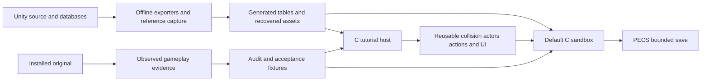

# Planet Explorers project map

This map locates the original Unity reference, the C rebuild and the evidence supporting replication. The immediate implementation direction is sandbox gameplay alignment. The main menu connects both hosts. They share recovered presentation assets, while sandbox progression and tutorial lesson state remain separate. The sandbox owns general source-timed shovel/pickaxe/axe actions and now has recovered archived Westina and Eitai with the welcome-to-supplies dialogue flow; its local placement remains provisional. Welcome cancellation/resume and final Arrival handoff, supplier dialogue, one-time grant and reload passed physical-input verification.

## Read in this order

| Need | Start here |
|---|---|
| Instructions for future agents | [AGENTS.md](AGENTS.md) |
| Build, run and controls | [rebuild/README.md](rebuild/README.md) |
| Overall scope and delivered systems | [Replication specification](docs/REPLICATION.md) |
| Next sandbox milestone and live original fixtures | [Sandbox alignment](docs/audit/SANDBOX_ALIGNMENT.md) |
| What was actually tested | [Playtest record](docs/PLAYTEST.md) |
| Launch the installed original | [Reference runtime](docs/REFERENCE_RUNTIME.md) |
| Search dependencies and asset identity | [Local knowledge graph](docs/KNOWLEDGE_GRAPH.md) |

## Directory map

| Location | Role |
|---|---|
| [Assets](Assets) | Original C#, serialized Unity content, shaders, metadata and embedded database. Reference input. |
| [ProjectSettings](ProjectSettings) | Unity version/build configuration. Reference input. |
| [ConfigFiles](ConfigFiles), [config](config), [i18n.db](i18n.db) | Original configuration and localization. |
| [TutorialMode](TutorialMode), [CustomGames](CustomGames), [RandomTownArt](RandomTownArt), [CustomSounds](CustomSounds) | Original terrain/scenario/town/audio fixtures; not a complete installed game. |
| [rebuild/src](rebuild/src) | C11 runtime, headless state/geometry and raylib presentation. |
| [rebuild/generated](rebuild/generated) | Exported C tables/text/mound data and provenance manifests. Regenerate from tools. |
| [rebuild/tools](rebuild/tools) | Offline exporters, reference launch/input/capture/analysis and structural indexer. |
| [rebuild/tests](rebuild/tests) | C, Python, source cross-check, CLI and graphics fixtures. |
| `rebuild/build` | Ignored executables, recovered runtime assets, expensive sampled animations, captures and local indexes. Not disposable as a whole without checking contents. |
| [docs/audit](docs/audit) | Source investigations and bounded implementation contracts. |
| [docs/reference](docs/reference) | Preserved screenshots/results, including [sandbox session metadata](docs/reference/sandbox/session.json). |

## Runtime ownership

The [Makefile](rebuild/Makefile) lists the actual `CORE`, `FRONTEND`, generated dependencies and test targets. The following groups are navigation aids, not independent libraries.

| Area | Main owners | Current boundary |
|---|---|---|
| Entry/main menu | [main.c](rebuild/src/main.c), [pe_app_menu.c](rebuild/src/pe_app_menu.c), [pe_sandbox_view.c](rebuild/src/pe_sandbox_view.c), [pe_game.c](rebuild/src/pe_game.c) | Menu routes retain sandbox state across tutorial visits; separate graphics sessions. Adventure starter/supplies, recipe knowledge, quickslots and bounded exploration. |
| Terrain | [pe_world.c](rebuild/src/pe_world.c), [pe_mesh.c](rebuild/src/pe_mesh.c), [pe_legacy.c](rebuild/src/pe_legacy.c) | Bounded density world, source marching cubes and read-only `.voxelform`/LZ4 crops; no full streaming/generator parity. |
| Terrain materials | [pe_terrain_material.c](rebuild/src/pe_terrain_material.c), [pe_terrain_material_view.c](rebuild/src/pe_terrain_material_view.c), [export_terrain_assets.py](rebuild/tools/export_terrain_assets.py) | Six recovered atlases,84 source IDs, triplanar triangle blending and crop-origin UVs. Synthetic palette aliases are presentation choices; simulation/save IDs stay unchanged. [Audit](docs/audit/SANDBOX_TERRAIN_MATERIALS.md). |
| Construction | [pe_block.c](rebuild/src/pe_block.c), [pe_training_build.c](rebuild/src/pe_training_build.c), [pe_training_receiver.c](rebuild/src/pe_training_receiver.c) | Shared packed Block45 geometry; sandbox transactions and tutorial point-brush/receiver host remain distinct. |
| Physics/query foundation | [pe_scene_collision.c](rebuild/src/pe_scene_collision.c), [pe_training_terrain.c](rebuild/src/pe_training_terrain.c), [pe_training_terrain_view.c](rebuild/src/pe_training_terrain_view.c) | BVH/capsule queries and tutorial render/collision snapshots. [pe_sandbox_collision.c](rebuild/src/pe_sandbox_collision.c) snapshots actual sandbox MC/Block45/box geometry and live source tree capsules for Adventure movement and save validation; tree-excluding geometry queries serve the camera. Snapshots are external to saved state. |
| Sandbox camera | [pe_sandbox_camera.c](rebuild/src/pe_sandbox_camera.c), [pe_sandbox_view.c](rebuild/src/pe_sandbox_view.c), [source camera audit](docs/audit/SANDBOX_CAMERA.md) | Source default/bounds and verified Unity 5.2 scalar SmoothDamp(.5 s); one display-frame clock with gated wheel input. Native camera offsets, activity-space scaling, clamp recovery and the remaining CameraForge graph differ. Tree layers remain excluded from camera blockers. |
| Persistence | [pe_save.c](rebuild/src/pe_save.c) | Validated PECS v6 bounded sandbox saves; v1–3 migrate as Legacy, while v4 Adventure can relocate a tree-overlapping player up to 3 m along a safe same-height path. Failed migration leaves current state unchanged. Welcome page0..9 (v4/v5 Adventure infer completed), Adventure progression/quickslots/HP and consumable clocks persist; not Unity saves or full tutorial persistence. |
| Tutorial state/controller | [pe_tutorial.c](rebuild/src/pe_tutorial.c), [pe_training.c](rebuild/src/pe_training.c), [pe_training_view.c](rebuild/src/pe_training_view.c) | Recovered-room lessons, movement/cameras, input and smoke sequence through construction; creation lesson 756 unsupported. |
| Sandbox tool clocks | [pe_sandbox_actions.c](rebuild/src/pe_sandbox_actions.c), [pe_sandbox_actions.h](rebuild/src/pe_sandbox_actions.h) | Transient, fixed-step source timing for Adventure items12/19/26/1527; one owner of authored events and renderer pose clocks. Source transitions are approximated; Wood Pickaxe19 has recovered Mine1–3 poses and exact event clocks. |
| Recovered sandbox trees | [pe_sandbox_world_view.c](rebuild/src/pe_sandbox_world_view.c), [export_sandbox_world_assets.py](rebuild/tools/export_sandbox_world_assets.py), [pe_tree_collision.c](rebuild/src/pe_tree_collision.c), [export_tree_collision.py](rebuild/tools/export_tree_collision.py) | Shared original diffuse tree at provisional saved positions; source trunk-capsule interaction rays, Adventure movement collision and depletion visibility. Generated headless constants match the visual PESC. No species generation or wind/LOD parity. |
| Tutorial tool and gathering actions | [pe_training_melee.c](rebuild/src/pe_training_melee.c), [pe_training_tree_hit.c](rebuild/src/pe_training_tree_hit.c), [pe_training_dig.c](rebuild/src/pe_training_dig.c), [pe_training_gathering.c](rebuild/src/pe_training_gathering.c) | Tutorial-specific grants, targets and progression remain here; the general shovel/axe host has no lesson side effects. General melee/gathering still need integration. |
| Actors and clips | [pe_actor.c](rebuild/src/pe_actor.c), [pe_actor_scene.c](rebuild/src/pe_actor_scene.c), [pe_actor_scene_view.c](rebuild/src/pe_actor_scene_view.c), [pe_player_locomotion.c](rebuild/src/pe_player_locomotion.c) | [pe_sandbox_actor.c](rebuild/src/pe_sandbox_actor.c) adapts recovered body locomotion, exact held/stowed tool scenes and shared shovel/felling action poses to the sandbox. Sampled animation, multipart appearances and rendering; not a full Animator/retargeting implementation. |
| Contact/creature rules | [pe_hitbox.c](rebuild/src/pe_hitbox.c), [pe_knife_contact.c](rebuild/src/pe_knife_contact.c), [pe_combat.c](rebuild/src/pe_combat.c), [pe_hare.c](rebuild/src/pe_hare.c), [pe_hare_attack.c](rebuild/src/pe_hare_attack.c) | Bounded source geometry/action helpers; general AI, encounter permission and survival still need a host. |
| Tutorial NPCs | [pe_training_npc.c](rebuild/src/pe_training_npc.c), [pe_training_npc_view.c](rebuild/src/pe_training_npc_view.c) | Nine recovered appearances/idles; not Adventure population logic. |
| Adventure encounters | [pe_adventure_npc.c](rebuild/src/pe_adventure_npc.c), [pe_adventure_npc_view.c](rebuild/src/pe_adventure_npc_view.c), [pe_adventure_dialogue.c](rebuild/src/pe_adventure_dialogue.c) | Archived Westina Nangle, entity20008/RandomNpc17/role1, plus Eitai Takayama, entity20016/RandomNpc22/role2, with recovered appearance/idle and source interaction capsules. Supported local placement near32,27 and relocation are provisional. Arrival uses a frozen initial anchor; only final source dialogue acknowledgment commits supplies through PeGame. Welcome ACK progress persists in PeGame; NPC poses and supplier dialogue pages remain transient. |
| UI | [pe_ui_assets.c](rebuild/src/pe_ui_assets.c), [pe_training_ui.c](rebuild/src/pe_training_ui.c), [pe_training_ui_layout.c](rebuild/src/pe_training_ui_layout.c) and `pe_training_ui_*` | Recovered atlas/font/effects with tutorial inventory, character, missions, Replicator and room minimap. [pe_sandbox_ui.c](rebuild/src/pe_sandbox_ui.c) and [pe_sandbox_ui_input.c](rebuild/src/pe_sandbox_ui_input.c) bind those assets/layouts to real PeGame state, the actual terrain minimap and an independent bounded build toolbar; routed clicks cannot also edit the world. |
| Text and content | [pe_content.h](rebuild/src/pe_content.h), [pe_training_text.c](rebuild/src/pe_training_text.c), [generated content manifest](rebuild/generated/content_manifest.json) | Selected original IDs/formulas and source dialogue; catalog breadth/unlock rules remain bounded. |

## Original source landmarks

| Question | Source location |
|---|---|
| Startup, mode and world loaders | [Assets/PeLauncher](Assets/PeLauncher), [SingleGameInitData.cs](Assets/PeWorld/SingleGameInitData.cs) |
| Entity state, motion and equipment | [Assets/Scripts/PeEntity](Assets/Scripts/PeEntity), [Assets/Scripts/Items](Assets/Scripts/Items) |
| Default controls | [PeInputSettings.cs](Assets/Scripts/Input/PeInputSettings.cs), [PeInput.cs](Assets/Scripts/Input/PeInput.cs) |
| Terrain/extraction/streaming | [Voxel source](Assets/Terrain/Voxelform2/Voxelform/Source), [world audit](docs/audit/WORLD.md) |
| Procedural world configuration | [RandomMapConfig.cs](Assets/Scripts/PuJi/Town/Tool/RandomMapConfig.cs) |
| Camera behavior | [Assets/PeCamera](Assets/PeCamera) |
| Pickaxe action and recovery | [Mine audit and capture plan](docs/audit/SANDBOX_PICKAXE.md); exact Wood Pickaxe19 identity, Mine1–3 clocks, captured mounts and the implemented bounded action group. |
| Adventure NPC interaction | [MousePicker](Assets/Scripts/MousePicker), [BiologyViewCmpt.cs](Assets/Scripts/PeEntity/Cmpt/BiologyViewCmpt.cs), [encounter audit](docs/audit/ADVENTURE_NPC.md); source4.5m bounds,100m camera ray and10m obstacle allowance. |
| Database and paths | [LocalDatabase.cs](Assets/Scripts/Database/LocalDatabase.cs), [GameConfig.cs](Assets/Scripts/System/GameConfig.cs), [localData.bytes](Assets/Resources/DataBase/localData.bytes) |
| Original UI | [PE_GameUI](Assets/Scripts/Chenzhi/NewUI/Scripts/PE_GameUI), [training UI audit](docs/audit/TRAINING_UI.md) |

Many Unity scenes/prefabs are binary and some required shipped content/plugins are absent. Use the serialized-asset exporters and installed reference where appropriate; a text search or structural graph cannot recover those relationships completely.

## Audit and exporter map

| Workstream | Evidence and tools |
|---|---|
| Sandbox | [Gameplay](docs/audit/SANDBOX_GAMEPLAY.md), [world](docs/audit/SANDBOX_WORLD.md), [presentation](docs/audit/SANDBOX_PRESENTATION.md), [general actions](docs/audit/SANDBOX_ACTIONS.md), [tool presentation](docs/audit/SANDBOX_TOOL_PRESENTATION.md); `export_sandbox_world_assets.py` |
| Content/terrain | [Content audit](docs/audit/CONTENT.md), [terrain parity](docs/audit/TERRAIN_PARITY.md), [Block45](docs/audit/BLOCKS.md); `export_content.py`, `export_mc_tables.py`, `export_training_terrain.py` |
| Player/actions | [Player recovery](docs/audit/PLAYER_ASSET_RECOVERY.md), [Animator bake](docs/audit/ANIMATOR_BAKE.md), [hitboxes](docs/audit/HITBOX_RECOVERY.md); `export_reference_player.py`, `reference_animator_bake.py`, `export_baked_knife.py`, `export_baked_axe.py`, `export_baked_shovel.py` |
| NPC/UI | [NPCs](docs/audit/TRAINING_NPCS.md), [UI](docs/audit/TRAINING_UI.md), [effects](docs/audit/UI_EFFECTS.md); `export_training_npcs.py`, `reference_npc_bake.py`, `export_training_ui.py`, `export_training_ui_effects.py`, `export_training_ui_text.py` |
| Adventure supplier | [Encounter and source window](docs/audit/ADVENTURE_NPC.md), [archived appearance](docs/audit/ADVENTURE_SUPPLIER_APPEARANCE.md), [grant provenance](docs/audit/SANDBOX_GAMEPLAY.md); `read_reference_adventure.py`, `export_adventure_supplier.py`, `export_adventure_npc_collider.py`, `export_adventure_dialogue.py`. Generated capsule/text headers and JSON provenance live in `rebuild/generated`; recovered multipart scene/PESC live under `build/reference-assets/adventure-supplier`. |
| Original operation | [Reference runtime](docs/REFERENCE_RUNTIME.md), [pose tool guide](rebuild/tools/REFERENCE_POSE.md); `launch_reference.py`, `reference_input.py`, pose/bake probes |

Tool names in this table live in [rebuild/tools](rebuild/tools). Individual audits and the rebuild README contain full ordered commands and prerequisites; exporter names alone are not a complete recovery recipe.

## Next implementation gates

The [sandbox work order](docs/audit/SANDBOX_ALIGNMENT.md) is the detailed authority. Mode/progression/inventory ownership, render-derived terrain/construction collision, save validation, recovered actors/UI and the first general source tool clocks are now connected. Next extend tool coverage and transition fidelity, broaden source resource definitions and species coverage, then survival/encounters. Chunk streaming and exact procedural-world generation are major separate stages.

The reference milestone is Westina welcome → Arrival → supplier interaction → source dialogue acknowledgment → learn → craft → equip → dig → build → save/reload. The archived supplier, headless query/placement and atomic dialogue/grant tests pass; the integrated supplier graphics/input check also passes. This does not recover the original town layout, population generation or wider NPC behavior. Single Player Build instead starts with stockpiles/known recipes and locked resource counts. Do not transplant its rules into Adventure or substitute the tutorial's fixed NPC roster for generated settlements.

Navigation maintained on 2026-10-05. Module descriptions reflect the October 5 implementation; original Adventure/Build observations remain dated October 3. Consult the playtest record for completed graphical runs rather than inferring validation from this index.

Supplier regression entry points: [adventure_supplier_fixture.c](rebuild/tests/adventure_supplier_fixture.c) creates an unclaimed, physically supported encounter save; [playtest_adventure_supplier.py](rebuild/tools/playtest_adventure_supplier.py) drives only the owned C window and verifies cancellation, final acceptance and reload. [Recorded evidence](docs/reference/sandbox/rebuild-supplier-result.json).

Welcome entry points: [flow audit](docs/audit/ADVENTURE_WELCOME.md), [appearance](docs/audit/ADVENTURE_WELCOME_APPEARANCE.md), `test_adventure_welcome.c`, and `playtest_adventure_welcome.py`. The existing supplier fixture accepts `--welcome` to create an untouched introduction save.

Shared panel positioning and tracker clearance live in `pe_training_ui_layout.c/.h`. `PeUIWindows` holds session-only offsets for the five movable panels; tutorial and sandbox must use the same translated draw/hit geometry. `playtest_ui_windows.py` exercises both hosts at1000×700 and1280×720.
