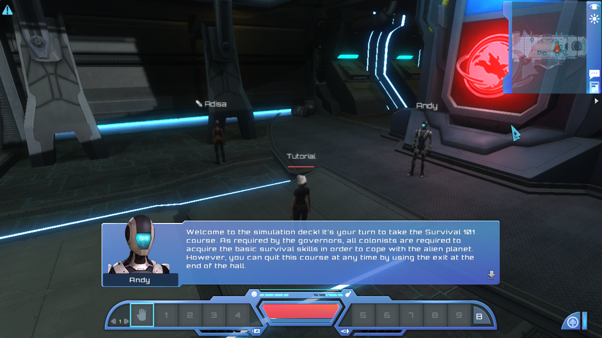

# Original game reference runtime

Investigated on 2026-10-03. **The original native Linux game V1.1.4 now runs, and its tutorial scene has been visually verified.** The main menu and simulation deck render, including the player, Andy's greeting, room, minimap, and hotbar. This establishes a usable packaged-game reference, not complete replication parity. No Unity editor has been launched, and the original Unity project has not been upgraded or modified. Ordinary Steam Play startup is not yet verified as fixed; the successful test used the direct native client and an isolated settings profile.

## Verified native runtime and diagnosis

The user installed the game through Steam. The restored native installation is at `/home/admin/.local/share/Steam/steamapps/common/Planet Explorers`; its `PE_Client.x86_64` executable reports Unity **5.2.4f1 (98095704e6fe)** and game **V1.1.4 Linux**. Two distinct failures were identified:

1. During the Windows/Proton attempt, `LauncherConfig.xml` still named the extensionless native target `PE_Client`, while the installed Windows client was `PE_Client.exe`. The launcher log ended with `can't find target:S:\steamapps\common\Planet Explorers/PE_Client`. This is a launcher target mismatch. The absence of OpenCL platforms in that launcher log does not prove the CPU game path is unavailable.
2. With the native files restored, a direct windowed CPU launch initialized Steam, the database, and CPU extraction, but displayed a black screen. `/tmp/pe-launch-diagnostics/native-windowed.log` shows the GLX configuration changing from zero to four samples when game settings were applied, followed by `BadMatch`, `GLXBadContextTag`, and `GLContext: failed to activate` errors.

The second native run kept the launch arguments identical and changed only `<AntiAliasing Index="1" />` to `<AntiAliasing Index="0" />` in the isolated generated settings file. The main menu then rendered and the tutorial loaded successfully. `/tmp/pe-launch-diagnostics/native-no-aa.log` records `[OCLLOG]Succeed to init with Cpu` without those GLX/context errors. `/tmp/pe-launch-diagnostics/tutorial-landscape.png` captures the rendered 1280×720 tutorial simulation deck and Andy's greeting. These are local diagnostic artifacts, not checked-in repository dependencies. The controlled change identifies the antialiasing/context transition as the operative native failure in this tested configuration; it does not establish a universal driver diagnosis.

The observed successful client command, run from the installed game directory with Steam running in the user's session, was:

```sh
./PE_Client.x86_64 -from-launcher -rw 1280 -rh 720 -ql 0 \
  -language English -ocl Cpu -screen-fullscreen 0 \
  -userpath /home/admin/source/planetexplorers/rebuild/build/reference-user-data \
  -logFile /tmp/pe-launch-diagnostics/native-no-aa.log
```

The settings file actually used was:

```text
/home/admin/source/planetexplorers/rebuild/build/reference-user-data/PlanetExplorers/Config/SystemSaveData.xml
```

This full generated profile has `SystemData Version="0.795"`, `QualityLevel Index="6"`, and `AntiAliasing Index="0"`. The game must retain its normal Steam initialization; this command is not an account or entitlement bypass. The command records the tested arguments, rather than a complete capture of Steam's inherited process environment.

### Persistent engine preferences and repeatable reference launch

Further testing found a second antialiasing entry point: Unity persists `UnityGraphicsQuality=3` when the game exits after applying custom quality level 6. On the next startup Unity can apply that cached engine quality before the game's XML settings load. Consequently, an XML-only fix does not reliably prevent a startup black screen.

The checked-in [`launch_reference.py`](../rebuild/tools/launch_reference.py) prepares both the game settings (`QualityLevel=6`, `AntiAliasing=0`) and engine preferences (`UnityGraphicsQuality=0`) before starting the native client. It sets `XDG_CONFIG_HOME` to the reference profile's `engine-config` directory. Unity 5.2.4f1 was observed writing its preferences there, confirming that this engine version honors that isolation. The helper was then executed after an earlier run had persisted quality 3 in its own preferences; it backed up those preferences, reset the value to zero, and reached the rendered main menu again with CPU initialization and no GLX errors.

From the repository root, with Steam running:

```sh
python3 rebuild/tools/launch_reference.py
```

The default helper profile is `/home/admin/.local/share/planet-explorers-reference`. Its game settings and saves live below `PlanetExplorers`; engine preferences live at `engine-config/unity3d/Pathea Games/Planet Explorers/prefs`. `--user-data` selects another whitespace-free profile root. The helper creates backups beside existing settings/preferences when it changes them and uses atomic replacement. It does not modify the shared Unity preferences or ordinary game saves.

The helper has now been verified end to end: the main menu rendered, Tutorial loaded, and the simulation deck displayed the avatar, Adisa, Andy, dialogue, hotbar, and minimap. CPU initialization was logged, with zero `GLContext` or `BadMatch` errors. The capture `/tmp/pe-launch-diagnostics/helper-tutorial.png` is preserved in the repository below. The earlier direct-launch capture remains `/tmp/pe-launch-diagnostics/tutorial-landscape.png`. All 12 launcher-helper tests pass, alongside the core tests and 10 content tests.



### Ordinary Steam launch changes and rollback

The normal Steam launcher itself renders. Its first native client attempt hit the cached shared `UnityGraphicsQuality=3` startup failure before the game profile loaded. The shared preference was subsequently reset to zero, and the ordinary profile was set to quality 0 with antialiasing off. Later launcher automation did not start a client, so ordinary Steam Play is **not yet verified as working** after those changes.

The following external configuration changes were made during that separate troubleshooting path; they are not changes performed by the isolated reference helper:

| File | Change | Rollback evidence |
| --- | --- | --- |
| `/home/admin/.local/share/Steam/steamapps/common/Planet Explorers/OptionConfig.xml` | Windowed mode (`gameFullScreen=false`), `UserDataPath=/home/admin`, CPU selection. | Original saved beside it as `OptionConfig.xml.before-launch-fix-20261003-144221`. |
| `/home/admin/PlanetExplorers/Config/SystemSaveData.xml` | Created the previously absent profile; current values are `QualityLevel=0`, `AntiAliasing=0`. | There was no previous file to restore. |
| `/home/admin/.config/unity3d/Pathea Games/Planet Explorers/prefs` | Reset `UnityGraphicsQuality` to zero. | Original saved beside it as `prefs.before-launch-fix-20261003-144421`. |

To undo those external settings changes, first quit the game and launcher, restore the two named backup files to their original names, and move the newly created `SystemSaveData.xml` aside if returning to its prior absent state is desired. Keep any subsequent user settings before restoring a backup. No existing game-save files were overwritten during these launch fixes. For the reference helper, restoring its adjacent backups reverses settings changes; keep the separate reference profile if it contains captures or saves worth retaining.

### Settings and CPU-path source evidence

[`SystemSettingData.cs`](../Assets/Scripts/Lilj/SystemSettingData.cs) defaults antialiasing to 1. Under custom quality level 6, `ApplyVideo` explicitly sets `QualitySettings.antiAliasing` to four samples for a positive setting and zero otherwise. `LoadSystemData` loads `/PlanetExplorers/Config/SystemSaveData.xml` below the userdata root. Invalid XML falls back to defaults, including antialiasing 1. Missing nodes retain defaults and are filled when settings are saved; the version field does not cause wholesale rejection of this profile.

The following is a source-supported minimal fresh profile, but was **not separately launch-tested**; the successful test edited the full generated profile:

```xml
<SystemData Version="0.795">
  <QualityLevel Index="6" />
  <AntiAliasing Index="0" />
</SystemData>
```

`GameConfig` accepts an explicit userdata root only when the directory already exists, and otherwise uses Mono's `Environment.SpecialFolder.MyDocuments`. That value should not be assumed to equal the XDG Documents directory. Existing Steam cloud folders on this machine are under `/home/admin/PlanetExplorers`; using the explicit existing root `-userpath /home/admin` targets them unambiguously. The successful test used the separate repository build profile above, not that ordinary user profile.

[`PECommandLine.cs`](../Assets/Scripts/ZhouXun/CmdLine/PECommandLine.cs) requires `-from-launcher`; width and height arguments with no `-fs` select windowed mode. Its simplistic space-splitting parser requires userdata paths without spaces and should not be given a trailing unvalued option. The `-ocl Cpu` path in [`oclManager.cs`](../Assets/Terrain/Voxelform2/Voxelform/Source/Scripts/Voxel/MarchingCubes/Ocl/oclManager.cs) returns before OpenCL device creation; [`SufExtractorsMan.cs`](../Assets/Terrain/Voxelform2/Voxelform/Source/Scripts/Voxel/SufExtractorsMan.cs) then selects the CPU marching-cubes extractor. A usable OpenCL device is therefore unnecessary for this verified reference configuration.

## Adventure and Build reference session, evening 2026-10-03

The native original was also tested beyond Tutorial: a fresh Adventure Normal character completed the opening supply interaction, learned and crafted a Wood Shovel, equipped it, excavated terrain, placed dirt construction, saved and reloaded. A separate Single Player Build character verified its initial stockpiles/recipes, frozen13:00 clock and non-debiting dirt placement. Exact settings, screenshots, source distinctions and remaining checks are in the [sandbox alignment audit](audit/SANDBOX_ALIGNMENT.md).

This session used `/home/admin/.local/share/planet-explorers-sandbox-reference` as a fresh isolated profile. The first launch encountered `SqliteSyntaxException: no such table: skEffect`. Its preceding error was a disk-quota failure while writing `/tmp/yphow68d.ur8`. [LocalDatabase.cs](../Assets/Scripts/Database/LocalDatabase.cs) writes the bundled database to `Path.GetTempFileName()` before opening it; the missing table was downstream of the failed temporary copy. A process-local temporary directory on the home filesystem allowed the next launch to initialize and play:

```sh
mkdir -p /home/admin/.local/share/planet-explorers-sandbox-reference/tmp
TMPDIR=/home/admin/.local/share/planet-explorers-sandbox-reference/tmp \
  python3 rebuild/tools/launch_reference.py \
  --user-data /home/admin/.local/share/planet-explorers-sandbox-reference
```

The launcher does not itself set this `TMPDIR`; it is an explicit environment override. No game database/binary or Unity source was modified. The failed startup log is locally retained at `rebuild/build/sandbox-audit/startup-temp-error.log`; the successful Unity log lives under the profile's `engine-config/unity3d/Pathea Games/Planet Explorers/Player.log`. The [error screenshot](reference/sandbox/original-startup-temp-error.png) is retained with the successful gameplay captures.

Adventure manual slot1 (`GameSave/save0`, character `audit`) was saved and loaded successfully. Build manual slot2 (`GameSave/save1`, character `buildaudit`) was saved, but not reloaded in this pass. Both are below the isolated profile's `PlanetExplorers` directory; ordinary user saves were not overwritten. Afterward the original received Quit Game and its confirmation through the UI; PID1683328 was verified absent, and the launcher session returned143. That is the observed end of this user-requested quit, not a claimed zero-exit test or a new crash diagnosis. Ordinary Steam Play and Proton launch remain unverified.

## Initial local findings, before the Steam installation

`ProjectSettings/ProjectVersion.txt` specifies **Unity 5.2.4f1**. Bounded searches of `/opt`, the user's Downloads, `.local`, `.cache`, source directories, and standard Steam library paths found no Unity editor, Unity Hub, or original Planet Explorers executable. Wine, Steam, and .NET are installed. No default Steam game library or Planet Explorers manifest was present before the isolated download attempt.

The repository's [terms](../README.md) explicitly say third-party plugins were excluded. Some Behave and C5 managed assemblies remain, but the searches found no `Assets/Plugins` directory, native `.so` files, uLink assembly, Cloo wrapper assembly, or native `lz4_dll`. Source references remain in `Assets/Scripts/GameNetwork`, `Assets/PeAudio`, and `Assets/Terrain/Voxelform2/Voxelform/Source/Scripts/Voxel/VFDataReader.cs`. An editor installation alone would therefore leave unresolved compilation/runtime dependencies. This conclusion comes from source and filesystem inspection, not an attempted Unity compilation.

Approximately 171 GiB of disk space was available. OpenGL and OpenCL loader libraries are installed, but no OpenCL vendor files or `clinfo` command were found. A working OpenCL device was not established. The C rebuild uses CPU extraction and does not need OpenCL.

## Official download routes checked

### Exact Unity editor

The [Unity 5.2.4f1 release page](https://unity.com/releases/editor/whats-new/5.2.4f1) identifies revision `98095704e6fe`, released December 15, 2015. Its editor downloads are Windows and macOS; the page does not provide a native Linux editor for that release.

A HEAD request to the linked [Windows editor installer](https://download.unity3d.com/download_unity/98095704e6fe/Windows64EditorInstaller/UnitySetup64-5.2.4f1.exe) returned HTTP 200 and a content length of **2,035,506,632 bytes**. It was not downloaded or installed: Wine installation and editor activation would still leave the omitted project plugins unresolved. No Unity account or license activation was attempted.

### Packaged DRM-free game

The [official Pathea download page](https://planetexplorers.pathea.net/news/download) links the following packages. All returned **HTTP 404** during this investigation:

- [Windows x64 package](https://f001.backblazeb2.com/file/PlanetExplorers/Planet+Explorers_PC_X64.zip)
- [macOS package](https://f001.backblazeb2.com/file/PlanetExplorers/Planet+Explorers_Mac.zip)
- [Linux package](https://f001.backblazeb2.com/file/PlanetExplorers/Planet+Explorers_Linux.zip)

The Linux URL was checked with a literal plus sign, an escaped plus sign, and an escaped space. None yielded an archive. No third-party mirror was used.

### Steam Linux build

The [official Steam listing](https://store.steampowered.com/app/237870/Planet_Explorers/) lists the game as free-to-play, supports Linux, and identifies a third-party EULA. A stock packaged build would be a more direct behavioral reference than restoring the source checkout: it includes the built engine, middleware, and content.

The official Valve [SteamCMD bootstrap](https://steamcdn-a.akamaihd.net/client/installer/steamcmd_linux.tar.gz) was downloaded to `/tmp/pe-reference/steamcmd`. The bootstrap was about 2.31 MiB; the updated client occupied about 198 MiB. Only anonymous Steam access was used. No user credentials, account login, purchase, or EULA acceptance occurred.

## Earlier anonymous Steam probes and results

The following commands were executed against the isolated SteamCMD client:

```sh
/tmp/pe-reference/steamcmd/steamcmd.sh \
  +login anonymous +app_info_print 237870 +quit

/tmp/pe-reference/steamcmd/steamcmd.sh \
  +force_install_dir /tmp/pe-reference/game \
  +login anonymous +app_update 237870 validate +quit

/tmp/pe-reference/steamcmd/steamcmd.sh \
  +login anonymous \
  +download_depot 237870 237873 2660877840910546897 +quit
```

The metadata query succeeded and identified `PE_Launcher` as the Linux executable. The public Linux depot and shared depot metadata reported:

| Depot | Public manifest | Installed bytes | Download bytes |
| --- | --- | ---: | ---: |
| 237873, Linux | 2660877840910546897 | 4,178,669,062 | 1,293,003,200 |
| 237875, shared | 3229754379934124198 | 2,002,228,225 | 2,021,655,136 |
| 237876, shared | 368635098403920417 | 6,939,282,383 | 3,320,856,816 |

If all three are required, these total approximately **13.12 GB installed and 6.64 GB downloaded**. This is a metadata-based estimate, not an observed completed installation.

`app_update` timed out waiting for its update to start, then misleadingly printed a successful installation message. Inspection found **zero installed bytes and zero mounted depots**. The destination contained only a 588-byte app manifest; there was no game executable.

The explicit Linux depot request established the actual gate:

```text
Depot download failed : missing license for depot (No subscription)
```

The session's temporary logs are `/tmp/pe-reference/steamcmd-info.log`, `/tmp/pe-reference/steamcmd-install.log`, and `/tmp/pe-reference/steamcmd-depot.log`. These paths are investigation artifacts and are not repository dependencies. SteamCMD also wrote its ordinary client logs under the existing Steam log directory; account configuration secrets were not read.

## Remaining reference work and editor limitations

The user's later Steam installation supersedes the anonymous access gate documented above. The isolated native tutorial run is verified; a persistent fix for ordinary Steam startup remains a separate validation step. No account or license decisions were made on the user's behalf during the anonymous probes.

The editor route requires the exact Unity version, a valid activation path, and the omitted dependencies. Any attempt should use an isolated project copy and retain the original checkout unchanged. Upgrading to a newer editor would add conversion changes before a baseline has been captured.

Original multiplayer is a separate limitation. In its [June 24, 2019 announcement](https://store.steampowered.com/news/?appgroupname=Planet+Explorers&appids=237870&feed=steam_community_announcements), Pathea described the loss of lobby-server code and the defunct U-link middleware. A successful local editor or game launch would not restore that service.

Use the now-running reference to record graphics configuration, world seed or authored coordinates, inventory and equipped tool, then capture repeatable movement, mining, crafting, resource consumption, and save/reload observations. Turn those observations into comparison fixtures for the C rebuild. Tutorial rendering is confirmed; a successful launch by itself is not evidence of complete replication.

## Controlled play after launch

Automated input has completed the original camera, basic movement, location movement and storage interaction lessons. A full five-juice stack was transferred into inventory, and Andy requested the return trip. The [playtest log](PLAYTEST.md) records screenshots, the separate recovered C room preview, source-derived corrections, and remaining comparisons. This extends the launch-only evidence above; it does not establish completion of the whole tutorial.


## October6 user playtest crash

The [October6 crash evidence](reference/user-playtest-crash-20261006.json) and [playtest](PLAYTEST.md#october-6--user-operated-original-combat-and-graphics-crash) document the repeated native graphics-worker fault without an injected observation probe. Both inspected cores fault while dereferencing0xc in generated `.gl` code, with matching NVIDIA OpenGL580.178.04 caller offsets. This is not proof that a particular Unity action, asset, NVIDIA bug or external recording caused it. No OOM kill was logged in the inspected interval. Original manual slots5/6/7 remain byte-identical to their archived hashes.

For the next **diagnostic comparison**, NVIDIA's installed README at `/usr/share/doc/nvidia/html/openglenvvariables.html` documents disabling executable-memory optimizations with `__GL_WRITE_TEXT_SECTION=0`; [NVIDIA's published documentation](https://download.nvidia.com/XFree86/Linux-x86_64/570.181/README/openglenvvariables.html) describes the same control. Because the faulting PC lies in generated `.gl` code, trying that control is an inference-based isolation step, not an established workaround. It changes only the launched process, leaves driver/system configuration untouched and may affect performance:

```sh
TMPDIR="$PWD/rebuild/build/compiler-tmp" __GL_WRITE_TEXT_SECTION=0   python3 rebuild/tools/launch_reference.py   --user-data /home/admin/.local/share/planet-explorers-hunt-reference
```

This variation was tested later on October6 (PID1319444) and crashed again while advancing the defense briefing. It is not an effective fix for that run. The third core repeats the same `mov (%rsi),%edi` dereference with RSI0xc in generated `/memfd:/.glXXXXXX` code. Its first five NVIDIA caller offsets match the user-play crash exactly. The [comparison report](reference/reference-render-diagnostics-20261006.json) records this evidence; the extracted private core copy was deleted. Local evidence is `rebuild/build/user-playtest-20261006/retry-no-execmem{,-player}.log`.


## October6 single-threaded rendering diagnostic

The optional launcher switch below inserts Unity's `-force-gfx-direct` before the valued game arguments. Never append that valueless switch at the end: the original `PECommandLine` reads the next token unconditionally and throws `IndexOutOfRangeException`. That argument-order failure was observed separately and is not a graphics crash.

```sh
TMPDIR="$PWD/rebuild/build/compiler-tmp" python3 rebuild/tools/launch_reference.py \
  --user-data /home/admin/.local/share/planet-explorers-hunt-reference \
  --single-threaded-rendering
```

**Observed, limited diagnostic success:** PID1335454 loaded preserved manual7, completed the return and defense briefings, saved new manual8 during defense preparation, and remained alive through both waves and mission completion. No player attacks were issued during defense. New manual9 preserves completion. Reloading manual8 returned to active defense with0/15 and two waves; a later frame showed the first wave starting. The operator then used Quit Game and its confirmation; launcher status143 is recorded rather than claiming a clean exit0. No graphics crash was seen during this launch, which included menu, pause and loading time. This one run does **not** prove long-term stability, fix ordinary Steam/Proton startup, or establish a particular driver bug. No system or driver configuration was changed. The source runtime log remains local at `rebuild/build/user-playtest-20261006/retry-gfx-direct-02.log`.

[Active](reference/town-defense-original-active.json) and [complete](reference/town-defense-original-complete.json) archives preserve source identity and hashes. Earlier manual5–8 archives were unchanged when the completion audit ran. The completion archive lists9077 as complete and no active/random mission;9078/9079 were not automatically accepted. See the [Town Defense audit](audit/ADVENTURE_TOWN_DEFENSE.md).

The later [shield observer comparison](reference/shield-observer-crash-20261006.json) reproduced the same generated OpenGL fault even with `-force-gfx-direct`; it is not a reliable crash fix. `reference_pose.py --single-threaded-rendering` now forwards that existing diagnostic option. A process-only `__GLX_VENDOR_LIBRARY_NAME=mesa LIBGL_ALWAYS_SOFTWARE=1` observer launch recorded187 frames under llvmpipe, but qualified no block poses and ran slowly. Its [bounded report](reference/shield-observer-software-20261006.json) establishes neither long-term stability nor repaired Steam/Proton startup. No system graphics settings were changed.

## October6 Zink hardware-accelerated comparison

After the user reported llvmpipe was too slow to interact with, a process-only [Zink](https://docs.mesa3d.org/drivers/zink.html) launch used OpenGL through Vulkan on the QuadroK1200. `glxinfo -B` reported `Accelerated: yes`; the original Player.log confirmed that same Zink GPU renderer, and the main menu rendered. Asked about responsiveness after loading manual1 `audit`, the user answered “Yes, playable now.” This is a usable workaround for the current test, not a measured frame-rate result or demonstrated permanent crash fix. See [bounded evidence](reference/shield-zink-workaround-20261006.json).

```sh
env -u LIBGL_ALWAYS_SOFTWARE \
  __GLX_VENDOR_LIBRARY_NAME=mesa MESA_LOADER_DRIVER_OVERRIDE=zink \
  GALLIUM_DRIVER=zink VK_DRIVER_FILES=/usr/share/vulkan/icd.d/nvidia_icd.json \
  TMPDIR="$PWD/rebuild/build/compiler-tmp" \
  python3 rebuild/tools/launch_reference.py --single-threaded-rendering \
  --user-data /home/admin/.local/share/planet-explorers-sandbox-reference
```

The tested launch used `reference_pose.py --launch` with these same environment variables and an initially unarmed read-only observer; the command above is the ordinary launcher equivalent without capture. Do not start another instance over an active session. The paths require the already installed Mesa Zink and NVIDIA Vulkan ICD on this machine. No packages, system configuration or Steam launch preferences changed.

The subsequent backward-clip sampler startup crashed before arming under the same Zink environment (PID2269587, signal6). The prior playable recording remains valid, but this recurrence rules out treating Zink as a reliable startup fix. The new stack crosses a Zink queue worker and NVIDIA driver code, distinct from the earlier generated `.gl` fault; diagnosis and a process-only synchronization comparison are separate evidence.

A retry adding `ZINK_DEBUG=flushsync,nobgc` reached the tutorial and completed the48-sample Sword backward bake plus120 cleanup-survival frames. The operator advanced Andy dialogue, opened SYSTEM and used Quit Game→YES; launcher137/rawSIGKILL follows the known original self-kill pattern, not exit0. This one successful comparison does not identify the crash cause or prove synchronization flags are a permanent fix. The preceding [startup crash audit](reference/sword-backward-zink-crash-20261006.json) records a driver near-null read through Gallium with no inspected OOM evidence.
