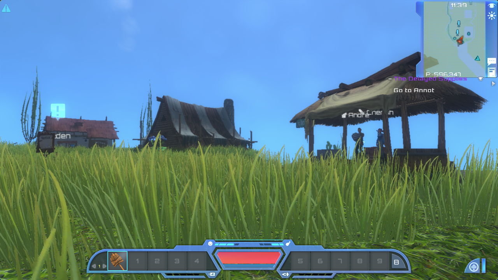
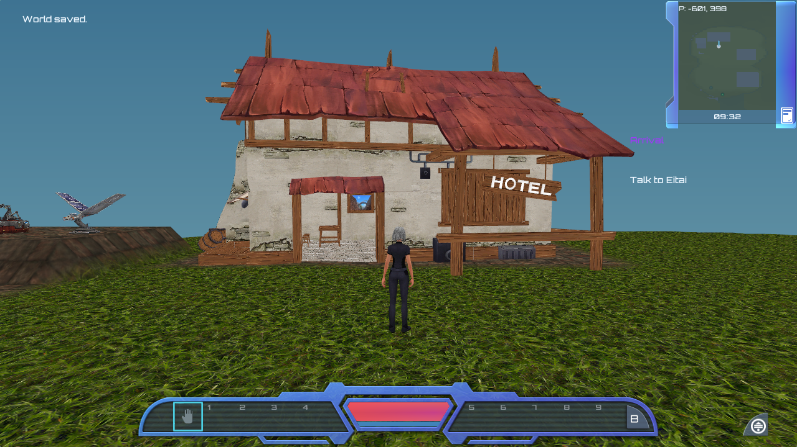

# Archived starting settlement integration

Implemented and tested October 5, 2026. New Sandbox now starts in one recovered original Adventure settlement. This is a bounded replication fixture, not the original procedural world generator. Existing saves and explicit terrain imports retain their own worlds.

## Evidence and assets

The preserved Adventure archive fixes six building transforms, Westina/Eitai poses, and the initial player spawn. [Placement and quest audit](ADVENTURE_COLONY_MARKERS.md) documents those records. The [terrain audit](ADVENTURE_SETTLEMENT_TERRAIN.md) records a read-only observation probe in the Steam native V1.1.4 client, Unity 5.2.4f1. The original loaded manual slot 1 through its normal UI in a copied profile; all 30 source save hashes remained unchanged.

The capture covers original origin `(-627,16,323)`, dimensions `64×32×128`, in x-fast volume/material pairs. Thirty loaded LOD0 chunks were stable across two frames. It includes the archived player's terrain edits. Comparing the town artifact overlay found 10,268 of 10,269 checked samples identical; the one different air sample is preserved, not replaced by an inferred fresh world.

`export_adventure_settlement_assets.py` recovers the store, noticeboard, hotel, dwelling, repair machine and solar generator. It replaces each prefab root transform with the archived entity pose, preserves child transforms, and applies the original alive-model initialization to exclude destroyed variants. The result is 40,820 visual triangles, ten materials/nine diffuse textures, and 920 collision triangles from four MeshColliders and two BoxColliders. The machines use serialized skinned rest poses. The strict production OBJ/MTL validator accepts the output; independent regeneration matches.

The screenshots show different viewpoints and rendering systems; they are evidence of integration, not a pixel comparison.

## Runtime ownership

`pe_settlement` loads the bounded PEVX terrain transactionally, supplies archived NPC anchors, and owns immutable building collision for the process. The profile matches source 1, depth 128 and the exact crop origin. Asset configuration precedes initialization/loading; changing the asset directory after collision snapshots borrow it is rejected. Matching worlds fail closed when building collision is unavailable.

General world, mesh, collision, game, tool-action and minimap paths use the active depth. Default synthetic generation and old `.voxelform` imports remain 64 samples deep. New sandbox sessions load the recovered crop and face into the town; `--seed` retains its metadata role but does not regenerate this fixed layout. The welcome still uses that numeric seed label.

Westina and Eitai retain archived XZ and source headings in degrees. Vertical settling uses actual terrain/building support after edits, without searching for an alternative XZ. The initial Arrival anchor remains immutable. Its integer truncation occurs in original world coordinates, which matters for negative X, before applying the strict 5 m XZ test.

Building surfaces participate in capsule movement, camera sweeps, rays, NPC obstacle queries, pre-action obstruction, resource edits, placement and save-spawn validation. Placement checks an inset AABB against triangles; this is conservative for ramp shapes and does not classify the interiors of arbitrary closed meshes as filled solids. NPC/player layer self-collision remains disabled as in the source.

The sandbox's 3D projection reflects X to present Unity's left-handed source coordinates correctly. Screen rays, NPC labels, horizontal mouse rotation and strafing use the corresponding mapping; the 2D UI is unchanged. This fixes mirrored signs and town orientation. Tutorial presentation remains a separate host.

PECS v7 retains the complete v6 prefix, appends depth 64/128 after `welcome_page`, then appends extra Z64–127 voxel pairs for depth 128. Versions 1–6 load as depth 64 with cleared inactive samples. The original default-world hash and earlier migrations are retained. Corrupt headers, lengths, checksums, depths and invalid geometry fail without replacing the running game.

## Verification

- Optimized core and full ASan/UBSan/leak checks passed, including actual recovered terrain/building assets. New coverage includes extra-depth mesh/rays/movement, a full timed shovel strike at Z95, old-save migrations, malformed payload atomicity, static obstruction, source NPC placement and actual settlement save/load.
- UI routing and all 23 CLI tests passed. Settlement metadata, six-building asset and terrain exporter tests passed; generated asset checks match.
- Physical input in the C window verified New Sandbox through the main menu, nine welcome acknowledgments, walking beyond the prior crop boundary, hotel wall blocking, F9/F10 persistence, returning downhill to Eitai, automatic Arrival, free-cursor right-click selection after projection correction, and the final supply grant. The corrected hotel sign reads normally. Native tests recorded no unintended tool swings or resource changes.
- The [result manifest](../reference/settlement/result.json) preserves capture hashes and observations. [Welcome](../reference/settlement/rebuild-new-sandbox.png), [wall contact](../reference/settlement/rebuild-wall.png), [NPC menu](../reference/settlement/rebuild-npc-menu.png), and [supplies](../reference/settlement/rebuild-supplies.png) are bounded C evidence.

## Remaining parity

Only Westina and Eitai are populated. Other archived townspeople, shops, scheduling/recruitment, working repair/solar interactions, doors, and original machine animation remain incomplete. Grass/vegetation, full shaders/lighting, sky, water and streaming are not recovered by this milestone. The crop ends at fixed boundaries and has no continuation into the surrounding world.

Annot is town 4, with archived target 4503 at `(-284,25,134)`, outside this crop. [Route](ADVENTURE_ROUTE.md) and [town interactions](ADVENTURE_TOWN_INTERACTIONS.md) now integrate travel/discovery beyond this original crop. Empty candidate colony towns 1–3 are explicitly excluded from source map labels; the inspected save contains no colony-site map markers. No invented markers were added. The next bounded target is remaining settlement population/interactions, followed by a terrain corridor and the actual Annot destination/progression.
