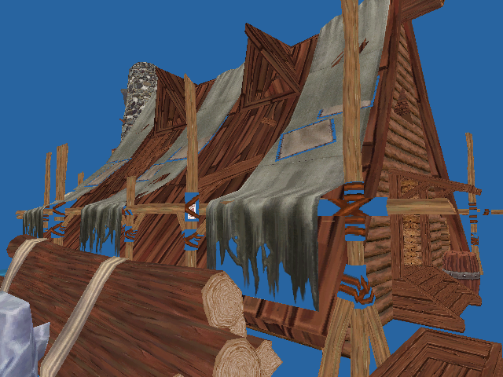
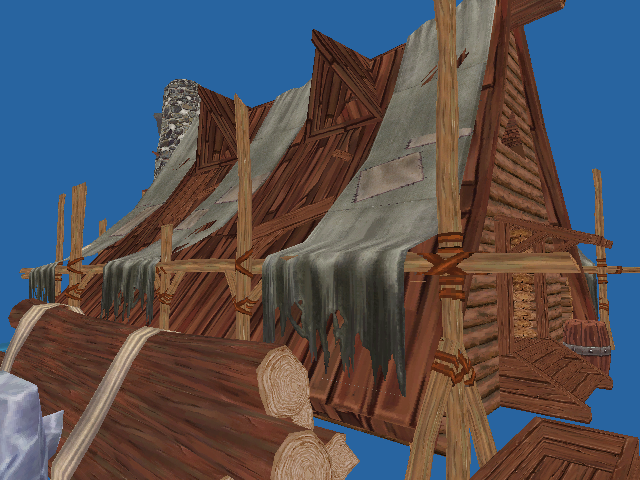

# Building materials and NPC label visibility

October 9, 2026. The user's 08:34–08:35 screenshots show sky-colored holes in
dwelling fabric and store thatch, and names projected through a hotel wall.
These are native observations. Bundle and exported-model hashes match their
archives; the images alone do not prove corrupt mesh topology.

## Source-derived material contract

Store `Town2_store01` and dwelling `town2_dwelling01B` use `_Mode=1`,
`_ALPHATEST_ON`, `_Cutoff=0.699999988079071` and `DoubleSideStdShell`.
Enabled, attached `ReplaceShaderU3D` components on each renderer's transform
ancestry qualify replacement with `DoubleSideStdEntity`, whose forward pass
uses `Cull Off`. Hotel roof `town2_hotel01A` uses ordinary Standard cutouts with
the same cutoff. These facts come from installed serialized objects and pinned
shader/replacement source, not texture statistics or material names.

`export_reference_materials.py` reuses actor material policy and exact renderer
ancestry qualification. It checks archived bundle hashes, material identity and
properties, renderer material slots and installed OBJ/MTL/PNG hashes. Conflicting
per-renderer policies for a shared material fail. Both installed crops are
qualified before installation; existing geometry, textures, collision and
archived manifests remain byte-identical.

## Implemented C contract

Optional `<model>.obj.materials` metadata uses bounded ASCII rows:

```text
PERM1 OBJ_FNV64 MTL_FNV64
symbol texture.png opaque|cutout|legacy cutoff alphaScale twoSided PNG_FNV64
```

Hashes are 16-digit FNV-1a64. Textureless materials use `-` and a zero texture
hash. Rows match MTL declaration order, exact symbols and texture names. Finite
canonical values and all input hashes are checked. Missing metadata retains
the previous diffuse adapter; malformed present metadata rejects the model.
FNV binds local inputs, not a cryptographic trust boundary; export evidence also
retains SHA256 provenance.

`pe_reference` owns the retained policy table and one shader, validates the
supported raylib material layout (with or without a leading default slot), and
sets the matching policy before each mesh draw. `pe_material_view.h` shares the
shader and culling scope with actors. Cutouts discard before depth writes;
passing fragments and opaque materials use opaque source output. Source alpha
affects the cutoff rather than blended opacity. Only qualified two-sided parts
temporarily disable culling; caller enable state and front/back selection are
restored. Render geometry and physical collision remain unchanged.

This is diffuse presentation, not Unity lighting/PBR, normal/specular maps,
shadows, fading or transparency sorting. Unsupported modes stay explicitly
legacy.

## Native NPC visibility adapter

Westina, Eitai and resident labels now use
`pe_sandbox_collision_label_visible`: a camera-to-anchor ray through the current
terrain, building, construction and live-tree perception snapshot. NPC bodies
and invented crop boundaries are excluded. The final 2 cm at the anchor avoids
endpoint surface noise; invalid inputs or unready snapshots hide labels.
Existing range, front-of-camera and modal rules remain. Picking and conversation
admission are unchanged.

This is the requested native visibility correction. The inspected original
`NpcOverHead.UpdateTransform` positions its UI in world space; this native ray
does not claim its UI depth, timing or fading behavior.

## Installation and verification

Regenerate after replacing a settlement OBJ group:

```sh
rebuild/build/unity-tools/bin/python rebuild/tools/export_reference_materials.py \
  --output rebuild/build/reference-materials-FRESH-NAME --install
rebuild/build/unity-tools/bin/python rebuild/tools/export_reference_materials.py --check
make -C rebuild reference-material-test
make -C rebuild reference-material-render-capture actor-material-render-capture
```

The output must be fresh. Staged sidecars, source evidence and prior
manifests/sidecars are retained before atomic per-file installation. The October9
stage/backups live under `rebuild/build/building-materials-20261009`.

The private GPU fixture reproduces legacy depth holes, then checks opaque output,
different cutoffs on shared textures, exact material-slot selection, reverse-side
cloth and culling enable/face restoration. Both crops have legacy/corrected
dwelling, store, hotel and store-underside captures on identical geometry.
Inspected images show fabric/backing gaps removed and the store underside
restored. A wall-label fixture hides the blocked label and preserves the clear
one. Shared actor portraits and GPU assertions also pass after extracting the
common helper. Headless parser tests reject stale OBJ/PNG hashes, extra rows,
nonfinite cutoffs and inconsistent opaque rules; collision tests cover clear,
wall/tree-blocked and invalid anchors.




[PLAYTEST](../PLAYTEST.md) records complete checks. Local captures/logs are in
`rebuild/build/reference-material-captures` and `building-material-*.log`.
Selected images and SHA256 hashes are preserved in
[the result record](../reference/building-materials/result.json). These are
controlled native fixtures, not ordinary gameplay acceptance or a new
original-game pixel comparison. No original launch, desktop input or normal
player save was used.
