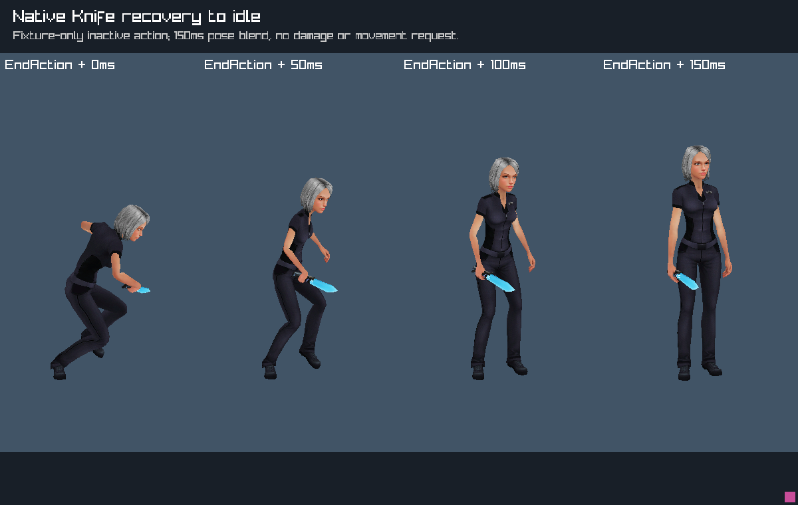
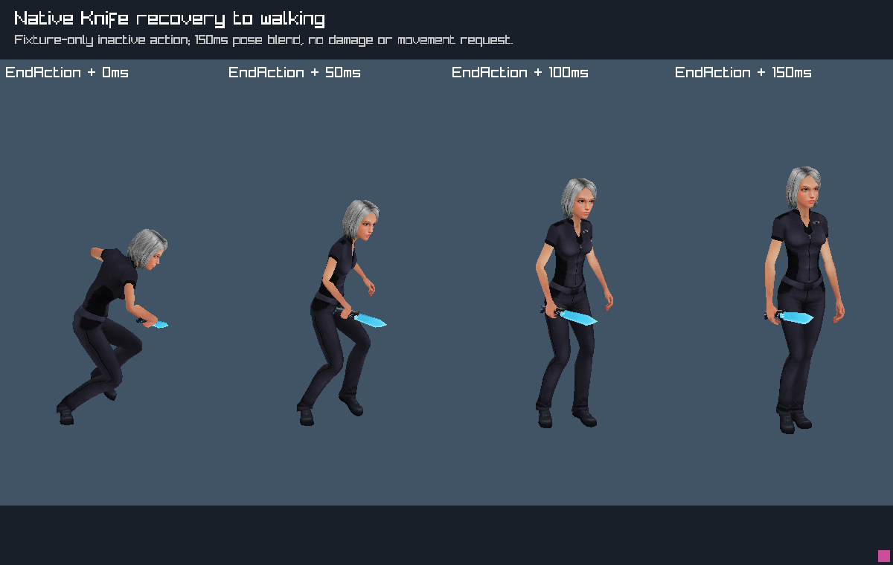

# Knife natural-end presentation recovery

October12,2026. **User-reported in the native game:** a single click followed
by waiting looks abruptly cut off, both standing and moving forward. This is
qualitative feedback; exact camera/settings, timing and contact outcome were
not recorded. No new original-game session was needed.

## Finding and implementation

Source-derived: female Attack6 is clip231,1.0666667222976685 seconds; its
mechanical EndAction event is0.7091259360313416. The installed controller779
has a separate unconditional attack exit, normalized time0.699999988079071,
fixed transition duration0.15000000596046448 and destination30025. Other
ordinary exits differ (Attack7:0.839122/0.160878s; Attack8:0.8/0.13s;
Attack9:0.715471/0.288341s). Installed sharedassets1 hash is
`d9c65f820a2186116d9eb73d815fe07d9f46924ddfd103ee9510bf254f9a3d67`.
`Action_Sword.OnEndAction` closes the action/movement requests and restores
Animator speed1; it does not force the clip immediately to idle.
The separate AnimatorLayerWeightCtr also fades its layer in DoNothing.
These are different clocks, not permission to move EndAction to clip end.

Implemented in C: the previous sandbox renderer discarded its melee pose as
soon as combat became inactive. It now retains a **native150ms linear recovery
adapter** at natural completion (retained combat event_index5), advances that
inactive clip at rate1 and blends into the existing locomotion snapshot.
This is a bounded correction for the abrupt handoff, **not** a port of the
installed transition/layer graph or Unity TRS blending. Recovery begins at
native action completion, rather than asserting the original normalized exit
or exact original fade shape.

Body, held weapon, optional supported shield and the read-only defence-facing
snapshot use the same blend weights and clocks. Capacity is13, allowing all12
locomotion contributors plus one recovery leaf; no weight is silently dropped.
Outgoing attacks remain mechanically inactive: damage windows, stamina,
combo admission, root displacement and the source lunge motor are unchanged.
A new attack overrides recovery. Pause freezes it. Explicit cancellation,
stow, death, airborne state, reset/load or instance change clears it; the host
cancellation sites clear both combat and actor presentation. The host binds
blade snapshots directly instead of first clearing them with a tool snapshot.
All recovery state is transient and unsaved; PECSv22 is unchanged.

## Checks and observed fixture

Focused actor tests verify natural-end continuity, shared body/weapon weights,
read-only pose queries, the advancing tail, pause, instance guards, expiration,
explicit cancellation and unchanged combat bytes. The extracted host input
fixture now mocks the additional actor cancellation callback; its original
movement/contact/UI assertions remain intact. The first full check failed to
compile that fixture because it had no actor context; the tracked extractor
and mock were updated, rather than editing generated build output. An
additional equipment-host mock still assumed external action clearing; it now
models the melee setter owning its binding and tests owner cancellation.

The final private render run is `rebuild/build/knife-recovery-captures-02`.
It draws actual sandbox actor recovery to idle and walking at0/50/100/150ms,
with a per-sheet readback token. The operator inspected both sheets: the body
and Knife return gradually rather than changing directly to locomotion.
This is staged rendering, not ordinary input acceptance or a new original
comparison. The final fixture uses free-pointer facing; an intermediate sheet
used captured-facing with an inconsistent fixture yaw and is superseded.





The same capture verifies all25 reaction leaves with exact drawn/stowed
Knife33 attachments and16 defence capsules. Those attachments were regenerated
with the unchanged `export_baked_knife.py` from the closed reaction01 capture,
original knife visual/collision metadata and matching body scene. They remain
uninstalled in `rebuild/build/knife-reaction-01-drawn` and `...-stowed`.
The cyan blade capsule is geometry only, shown outside any damage window for
inspection. [Retained result](../reference/knife-recovery-result.json) records
hashes and unchanged staged inputs; [sprint image](../reference/knife-sprint-preview.png)
qualifies isolated Knife attachment presentation, not sprint gameplay.

Reproduce with a fresh output directory:

```sh
make -C rebuild knife-reaction-render-capture \
  REACTION_CAPTURE_OUTPUT=build/knife-review-FRESH
```

Prerequisites and isolation follow [the reaction preview](REACTION_PREVIEW.md).
Full check, sanitizer and CLI results are in [PLAYTEST](../PLAYTEST.md).
The GPU fixture is optimized, not a GPU-driver leak check.

## Live retest and next work

Restart the rebuilt executable and repeat **one click, then wait** while
standing and while walking forward. Report whether the ending still snaps,
feels too short, or now recovers smoothly. If testing near a hare, distinguish
the appearance from actual damage; this change does not extend contact time.
Stow and opening a modal must still cancel immediately.

Sprint's remaining implementation is its distinct clip401 reader, separate
pose selection and retained outgoing-interval routing through shared
collision/contact handling. Root knots and Knife attachments are staged;
sprint readiness is still false. Live reactions/get-up and shield gates remain
closed.
