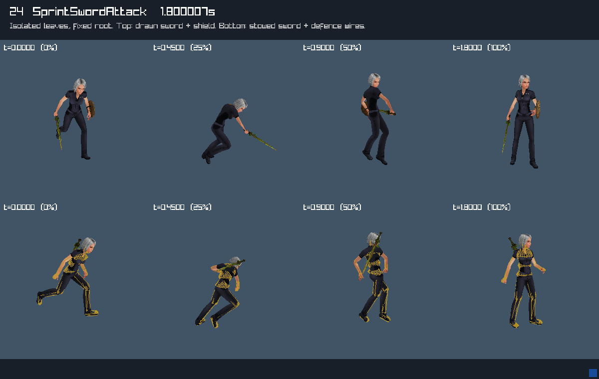
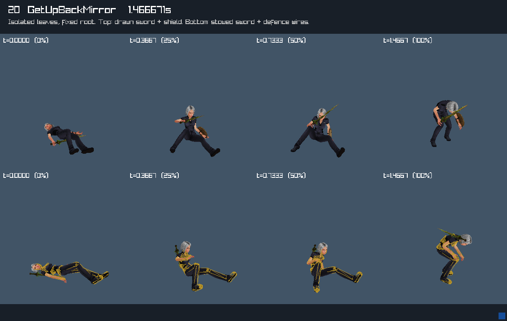

# Native staged reaction animation preview

October12,2026. **Observed in the C render fixture**, using the original
engine-baked isolated leaves from `female-reaction-01`; not a new original-game
observation or live gameplay acceptance.

`render_reaction_group.c` first loads the installed baseline and optional
reaction group through the actual `pe_sandbox_actor` GPU loader and checks
its separate25-clip defence actor. It then unloads the sandbox actor and uses
the common scene renderer to select each staged leaf explicitly. No production
pose selector, action admission, damage, saved state or equipment behavior
changes. This qualifies the optional actor's real GPU load, not the complete
sandbox host startup path or live reaction dispatch.

## Fixture and review

The final run, `rebuild/build/reaction-captures-04`, exited0 and closed its
window. The verified private launcher owned high display`:102`, stripped
WAYLAND_DISPLAY and used llvmpipe. No desktop input or original client was
used. The launcher creates a fresh asset root of symlinks: installed baseline
folders plus the five staged reaction roles. Installed asset folders remain
unmodified. It hashes every staged input before/after rendering and rejects
any change; the final input hashes agree.

All25 clips produce four phases (0,25%,50%,100% of their own duration) from
two views,200 panels total. The upper row shows the drawn wood sword and
shield; the lower row shows the stowed sword with16 defence capsule wires.
These are deliberate prop combinations for inspection, not source equipment
selection for every leaf. Body/attachment clips must match ordered identity,
duration, frames, FPS, loop and terminal policy. Defence clocks are validated
by the sandbox helper, and each panel samples all16 finite positive-radius
capsules at the exact same time and root. Loop endpoints use the shared
sampler's wrapping policy; there is no imposed nonloop endpoint for a loop.

The operator inspected an overview of all25 sheets and detailed sprint/get-up
sheets. Hit/stagger and get-up poses vary across phases; the near-static
BlockRepulsed leaf remains near-static. Sprint shows its attack poses at a
fixed root; the separate2.70m source displacement is **not** applied here.
Drawn/stowed props remain attached, and capsule wires follow the sampled
body. Get-up endpoints are the isolated authored leaves, not a guarantee of
an upright final idle or successful ragdoll recovery. No clipping outside the
panels or gross mesh separation was seen in this bounded review.

Representative native fixture sheets:





[Bounded result](../reference/reaction-preview-result.json) retains input and
representative image hashes. The complete25 PNGs, `poses.csv`, `result.json`,
render and Xvfb logs remain ignored under the final capture directory.

## Capture correction and reproduction

The first diagnostic run, `reaction-captures-01`, read the preceding frame's
back buffer: file names and the visible clip label disagreed. Those images
are unqualified. The renderer now draws each sheet twice and checks a unique
per-clip colour token in the readback before exporting it. Runs02/03 are
intermediate diagnostics; only run04 is retained as final evidence. The token
check prevents silently accepting the same stale-frame fault in another run.

From the repository root, with installed baseline assets, the staged reaction
group and privately extracted Xvfb already present:

```sh
make -C rebuild reaction-render-capture \
  REACTION_CAPTURE_OUTPUT=build/reaction-review-01
```

Choose a fresh directory each time; existing outputs fail before starting an
X server. The runner resolves the output path and requires it under
`rebuild/build`, preserves prior captures, uses the existing verified high-display
selection and tears down its owned server. It never adopts another display.
The renderer and supervisor run with a bounded180s capture timeout.

Full pre-commit and sanitizer registry results are in [PLAYTEST](../PLAYTEST.md).
The registry sanitizer run covers core suites; the actual GPU fixture ran
optimized, so this does not establish GPU-driver leak acceptance.

[Knife33 attachments and natural-end recovery](KNIFE_RECOVERY.md) are now
qualified in a separate fixture. Next: add a distinct clip401 root reader
with outgoing-interval motion/contact routing. [Sprint source knots](SPRINT_ROOT_CHANNELS.md)
are already staged. Live hit reactions, ragdoll/get-up, stun/knockback and shield
remain closed: this fixture supplies neither the Animator layer/blend solve,
AnimFollow PD/joints nor FinalIK.
